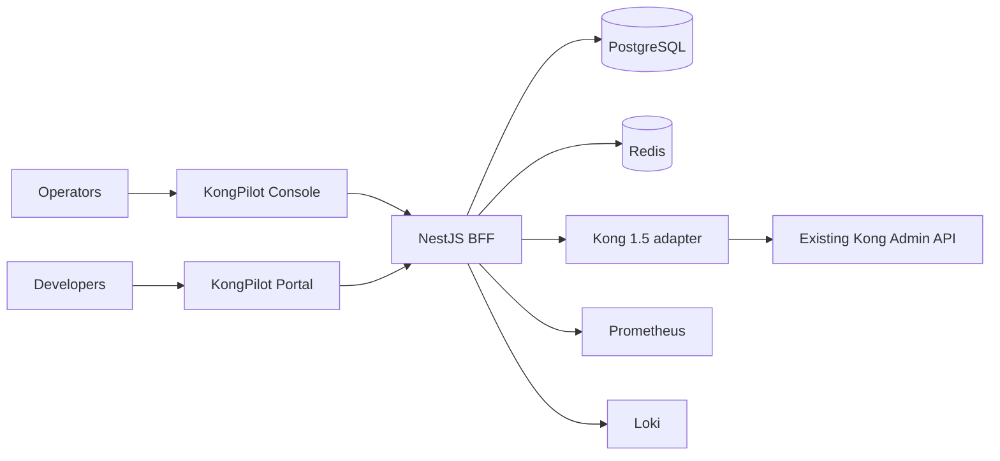

# KongPilot

[English](README.md) | [简体中文](README.zh-CN.md)

KongPilot is a self-hosted management console for **Kong OSS 1.5.x**. A dedicated NestJS BFF sits between the browser and the Kong Admin API, so users never touch the Admin API directly. It adds multi-cluster management, workspaces (tag-based soft isolation), entity and plugin management, RBAC, approvals/change tickets, snapshots and GitOps, monitoring (Prometheus/Loki), a developer portal, audit logging and notifications.

> Status: v1.0.0 release candidate. The UI is currently Chinese-only (`zh-CN`); an English locale is planned. KongPilot does not modify Kong and does not connect to Kong's database.

## Features

- Clusters & environments, Kong 1.5 compatibility layer, rate limiting / circuit breaking / locks
- Services, Routes, Upstreams/Targets, Consumers, Certificates, SNIs, six credential types, recycle bin with object-graph restore
- Plugin center with dynamic schemas, binding, enable/disable and priority view
- Users / teams / roles, four-dimension RBAC, sessions, secret reveal with audit
- Multi-stage / co-sign approvals, scheduled changes, diff / execute / rollback
- Config snapshots, YAML import/export, decK-compatible GitOps
- Vitals: traffic, latency and bandwidth via Prometheus/Loki
- Developer portal: docs, apps, credential request and lifecycle
- Append-only audit trail, event subscriptions and delivery (webhook / SMTP)

## Architecture



## Quick start

See [docs/quickstart.md](docs/quickstart.md) for a Docker Compose demo (Kong 1.5.1 + KongPilot). In short:

```bash
node deploy/scripts/generate-env.mjs .env   # random secrets, never commit .env
docker compose up -d --build
# console: http://127.0.0.1:8080  portal: http://127.0.0.1:8082
```

## Development

Requires Node.js (see `.node-version`) and npm.

```bash
npm ci
npm run typecheck
npm test          # vitest unit/security/integration suites
npm run build
```

Run locally with `npm run dev:api`, `npm run dev:web`, `npm run dev:portal` against your own PostgreSQL and Redis. The route simulator uses a native PCRE1 helper built from source (`apps/console-api/native-bin/`, not committed).

## Documentation

- [Quick start](docs/quickstart.md)
- [Manuals (zh-CN)](docs/manuals/README.md): operations guide, user guide, recovery runbook
- [Kong 1.5 compatibility](docs/kong-1.5-compatibility.md) / [decK compatibility](docs/deck-1.5-compatibility.md)

## Contributing & security

See [CONTRIBUTING.md](CONTRIBUTING.md) and [CODE_OF_CONDUCT.md](CODE_OF_CONDUCT.md). Please report vulnerabilities privately as described in [SECURITY.md](SECURITY.md).

## License

[Apache License 2.0](LICENSE). Kong is a trademark of Kong Inc.; KongPilot is an independent project and is not affiliated with or endorsed by Kong Inc. Bundled third-party notices: [NOTICE](NOTICE), [docs/licenses](docs/licenses/).
