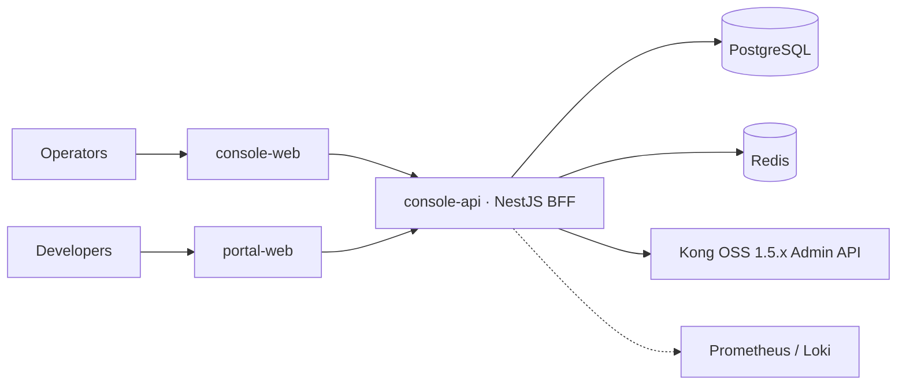

<p align="center">
  
</p>

<h1 align="center">KongPilot</h1>

<p align="center"><b>A governed, auditable management console for Kong OSS 1.5.x — approvals, GitOps, RBAC and a developer portal, without touching Kong.</b></p>

<p align="center"><b>English</b> · <a href="README.zh-CN.md">简体中文</a></p>

<p align="center">
  <a href="https://github.com/sean-y-wang/kongpilot-console/actions/workflows/quality.yml"></a>
  <a href="LICENSE"></a>
  <a href="https://github.com/sean-y-wang/kongpilot-console/releases"></a>
  
  
</p>

<p align="center">
  
</p>

## Why KongPilot

Kong OSS 1.5 ships without a management UI. KongPilot gives teams a safe one: every change is a reviewable ticket, every write is audited in a hash chain, and only a dedicated BFF ever talks to the Kong Admin API. It does not modify Kong and never connects to Kong's database.

> **Status:** v1.0.0 release candidate (`v1.0.0-rc.2`). The UI is Chinese-only today; an English locale is on the [roadmap](ROADMAP.md).

## Features

| | | |
|---|---|---|
| 🗂 **Entities** — Services, Routes, Upstreams/Targets, Consumers, Certificates, SNIs, six credential types | 🧩 **Plugin center** — dynamic schema forms, binding, enable/disable, priority view | 🌐 **Multi-cluster** — environments, Kong 1.5 compatibility layer, cluster-level write locks |
| ✅ **Approvals** — multi-stage / co-sign tickets, scheduled changes, diff / execute / rollback, explicit *unknown* results | 🔁 **GitOps** — snapshots, YAML import/export, decK 1.x-compatible | 🔐 **RBAC** — users, teams, four-dimension permissions, sessions, audited secret reveal |
| 📈 **Vitals** — traffic, latency and bandwidth via Prometheus / Loki | 🧑‍💻 **Developer portal** — docs, apps, credential requests and lifecycle | 🧾 **Audit & events** — append-only hash-chained log, webhook / SMTP delivery |

## Architecture



Data-plane traffic goes straight through Kong; KongPilot only handles configuration, approvals and audit. More in [docs/architecture](docs/architecture/README.md).

## Quickstart

```bash
git clone https://github.com/sean-y-wang/kongpilot-console.git && cd kongpilot-console
node deploy/scripts/generate-env.mjs .env   # random secrets — never commit .env
docker compose up -d --build                # console :8080, portal :8082
```

Then open <http://127.0.0.1:8080>. Full walkthrough: [Quickstart](docs/getting-started/quickstart.md).

## Documentation

- [Docs index](docs/README.md) — getting started, user guide, operations, architecture, reference, development
- [Architecture decisions](docs/decisions/README.md) · [Project history](docs/project-history/README.md) · [Changelog](CHANGELOG.md)
- [Kong 1.5 compatibility](docs/reference/kong-1.5-compatibility.md) · [decK compatibility](docs/reference/deck-1.5-compatibility.md)

## Roadmap

English UI locale, in-product reconcile for uncertain create operations, chunked large promotions — see [ROADMAP.md](ROADMAP.md).

## Contributing

Contributions are welcome! Read [CONTRIBUTING.md](CONTRIBUTING.md), the [development guide](docs/development/README.md) and our [Code of Conduct](CODE_OF_CONDUCT.md). Questions: [SUPPORT.md](SUPPORT.md). Governance: [GOVERNANCE.md](GOVERNANCE.md).

## Security

Please report vulnerabilities privately via GitHub's private vulnerability reporting — see [SECURITY.md](SECURITY.md).

## License

[Apache License 2.0](LICENSE). Kong is a trademark of Kong Inc.; KongPilot is an independent project, not affiliated with or endorsed by Kong Inc. Third-party notices: [NOTICE](NOTICE), [docs/licenses](docs/licenses/).
