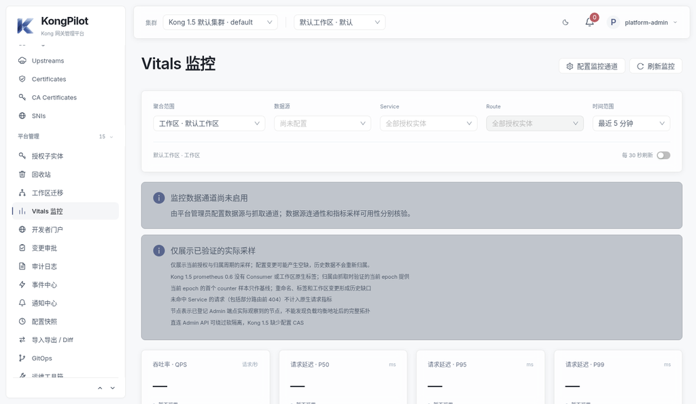
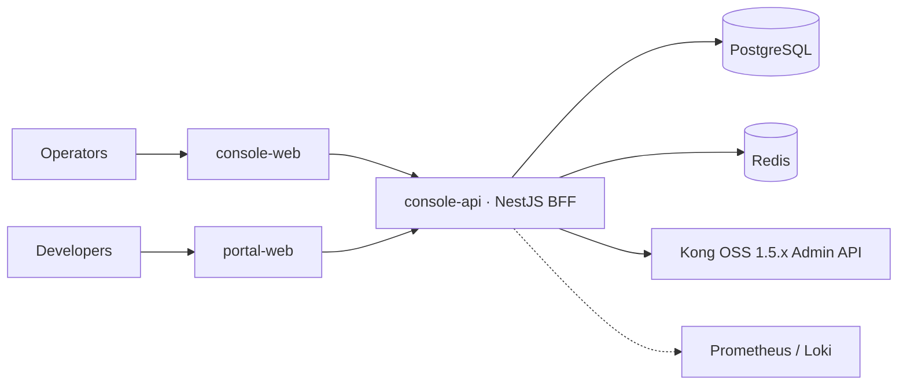

<p align="center">
  
</p>

<h1 align="center">KongPilot</h1>

<p align="center"><b>面向 Kong OSS 1.5.x 的可治理、可审计的管理控制台：审批、GitOps、RBAC 与开发者门户，不改动 Kong。</b></p>

<p align="center"><a href="README.md">English</a> · <b>简体中文</b></p>

<p align="center">
  <a href="https://github.com/sean-y-wang/kongpilot-console/actions/workflows/quality.yml"></a>
  <a href="LICENSE"></a>
  <a href="https://github.com/sean-y-wang/kongpilot-console/releases"></a>
  
  
</p>

<p align="center">
  
</p>

## 为什么选择 KongPilot

Kong OSS 1.5 没有自带管理界面。KongPilot 提供一个安全的控制台：每次变更都是可审核的工单，每次写入都记入哈希链审计，只有独立的 BFF 访问 Kong Admin API。不修改 Kong，也不连接 Kong 数据库。

> **状态：** v1.0.0 发布候选版（`v1.0.0-rc.2`）。界面目前仅简体中文，英文语言包见[路线图](ROADMAP.md)。

## 功能

| | | |
|---|---|---|
| 🗂 **实体管理** — Service、Route、Upstream/Target、Consumer、证书、SNI、六类凭证 | 🧩 **插件中心** — 动态 schema 表单、绑定、启停、优先级 | 🌐 **多集群** — 环境、Kong 1.5 适配层、集群级写锁 |
| ✅ **审批工单** — 多级 / 会签、定时变更、Diff / 执行 / 回滚、明确的"结果未知"处置 | 🔁 **GitOps** — 快照、YAML 导入导出、兼容 decK 1.x | 🔐 **权限** — 用户、团队、四维 RBAC、会话、带审计的秘密读取 |
| 📈 **Vitals** — 基于 Prometheus / Loki 的流量、延迟、带宽 | 🧑‍💻 **开发者门户** — 文档、应用、凭证申请与生命周期 | 🧾 **审计与事件** — 只追加的哈希链审计、Webhook / SMTP 投递 |

## 架构



业务流量直接走 Kong，KongPilot 只负责配置、审批和审计。详见 [docs/architecture](docs/architecture/README.md)。

## 快速开始

```bash
git clone https://github.com/sean-y-wang/kongpilot-console.git && cd kongpilot-console
node deploy/scripts/generate-env.mjs .env   # 生成随机密钥，切勿提交 .env
docker compose up -d --build                # 控制台 :8080，门户 :8082
```

打开 <http://127.0.0.1:8080>。完整步骤见[快速开始](docs/getting-started/quickstart.zh-CN.md)。

## 文档

- [文档索引](docs/README.zh-CN.md)
- [架构决策](docs/decisions/README.zh-CN.md) · [项目历程](docs/project-history/README.zh-CN.md) · [更新日志](CHANGELOG.md)
- [Kong 1.5 对接](docs/reference/kong-1.5-compatibility.md) · [decK 兼容](docs/reference/deck-1.5-compatibility.md)

## 路线图

英文界面、"结果不确定"创建操作的产品内对账、大规模推广分批——见 [ROADMAP.md](ROADMAP.md)。

## 参与贡献

欢迎贡献！请阅读 [CONTRIBUTING.md](CONTRIBUTING.md)、[开发指南](docs/development/README.md) 与[行为准则](CODE_OF_CONDUCT.md)。求助见 [SUPPORT.md](SUPPORT.md)，治理见 [GOVERNANCE.md](GOVERNANCE.md)。

## 安全

请通过 GitHub 私密漏洞报告提交安全问题，见 [SECURITY.md](SECURITY.md)。

## 许可证

[Apache License 2.0](LICENSE)。Kong 是 Kong Inc. 的商标；KongPilot 为独立项目，与 Kong Inc. 无关联。第三方声明：[NOTICE](NOTICE)、[docs/licenses](docs/licenses/)。
