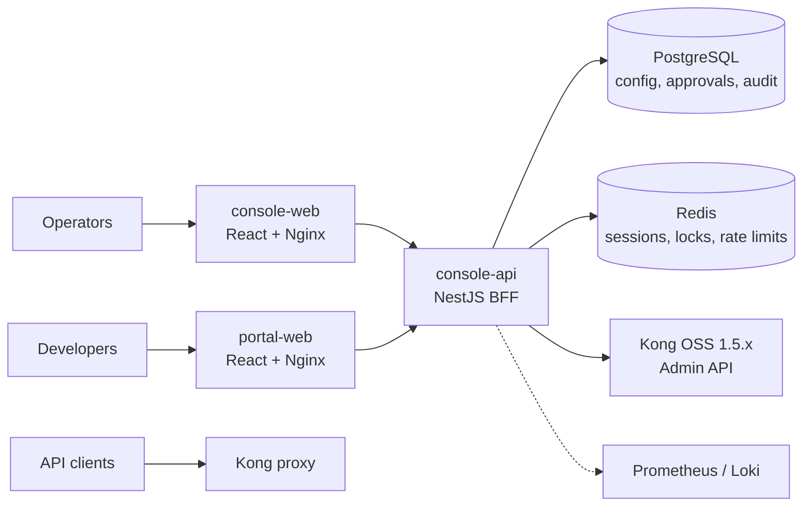

# Architecture

- **Only the BFF talks to the Kong Admin API.** Browsers never reach it; KongPilot never connects to Kong's database.
- **Data-plane traffic never passes through KongPilot.** Load is administrative only ([ADR 0002](../decisions/0002-no-write-sla-or-offsite-dr.md)).
- Shared types live in [`packages/contracts`](../../packages/contracts).

## Security model

Four-dimension RBAC (cluster × workspace × resource × action), server-side sessions in Redis, CSRF protection, SSRF-guarded destination resolution ([ADR 0008](../decisions/0008-destination-dns-c-ares.md)), audited secret reveal. Full review: [security-review.md](security-review.md).

## Approval workflow

Changes become tickets: author → one or more approvers (self-approval forbidden) → execution, immediately or on schedule. Each execution re-checks grants, holds a cluster-level write lock, has a fail-closed Kong call budget ([ADR 0009](../decisions/0009-scheduled-execution-call-budget.md)), and records results that cannot be confirmed as **unknown** instead of guessing. See [ADR 0001](../decisions/0001-approver-may-execute-approved-tickets.md) and [operations/approval-execution-separation.md](../operations/approval-execution-separation.md).

## Audit integrity

The audit log is append-only and hash-chained. `/audit/global/integrity` verifies 1000 rows per page and returns `nextCursor`; clients walk to the end ([ADR 0005](../decisions/0005-audit-integrity-pagination.md)).
