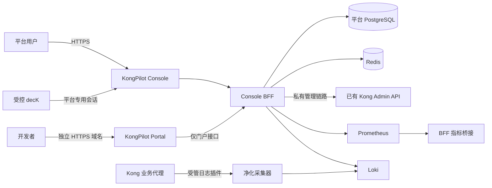

# KongPilot 部署与运维手册

**Kong 网关管理平台** · v1.0 · 仓库 `kongpilot-console` · M0–M10 已技术验收，M11 分项交付中 · 更新日期 2026-10-15

本手册面向部署工程师、平台管理员和运维值班人员，按照环境准备、安装、接入、验证、维护和恢复的顺序介绍 KongPilot。日常页面操作见 [用户使用手册](console-user-guide.md)。KongPilot 是独立的管理平台，仅通过 Kong OSS 1.5.x Admin API 管理网关配置；**不修改 Kong 源码、镜像或插件实现，不直连或改动 Kong 数据库**。平台数据库与网关存储分离，已有 Kong 不需要因安装控制台而替换。

平台应用技术验收与正式站点准入分别判断。M0–M10 已有功能、权限、凭证、审计与恢复证据；隔离验收环境不能代替持久生产站点。发布必须冻结 KongPilot 的源码、镜像和 SQL 摘要，完成平台依赖处置、持久部署、恢复演练及首期启用提供者的现场联调。旧发布包保留原摘要，不能仅改标签就作为新品牌版本。

**M9、M10 已完成技术阶段验收，M11 正在完成最终集成与验收。** 本轮新增控制面配置、身份权限、监控通道和实体说明审批，并补充凭证、Target 与定时变更入口。历史分项成功、迁移试验或当前源码构建通过均不能替代最终冻结包的验收。正式生产部署继续使用本手册的生产入口；实验 Compose、开发绑定和 RAM 验收环境不作为生产安装方案。当前状态统一见 M11 进展 和 已提交检查点。

## 1. 先确定部署方式

| 场景 | 推荐方式 | 是否启动 Kong |
| --- | --- | --- |
| 已有生产 Kong 1.5.x | 管理平台独立部署，叠加 `compose.external-kong.yml` | 不启动自带 Kong 或 Kong 数据库，不替换已有网关 |
| 新建演示/兼容验证环境 | 基础 Compose + 对应环境配置 | 启动官方 `kong:1.5.1` 与专用 PostgreSQL |
| 已有 KongPilot/KongOS 环境升级 | 沿用原 Compose project、卷、数据库和密钥 | 只更新明确选定的平台服务 |

使用平台监控、门户或配置发布时，平台会按授权通过 Admin API 配置原生插件和实体。这属于网关配置变更，需纳入业务变更管理。平台不修改 Kong 源码或插件实现。

## 2. 架构与网络边界



- 浏览器访问 Console/Portal；前端不保存 Admin 凭证、不请求 Kong 8001。
- 平台 API 使用独立数据库和 Redis。平台运行账号不持有数据库 owner 密码。
- 远端 Admin 仅允许受管 BFF 出口访问；跨机器采用受管 TLS/mTLS 管理入口或私有隧道。
- Portal 与 Console 使用独立域名、会话和签名密钥。Portal 入口不能代理控制台 API、Swagger 或私有指标接口。
- Prometheus、Loki、collector、decK 不加入 Admin/网关存储网络。平台指标桥接按专用用途 token 授权。
- 工作区是标签软隔离，不能替代独立网关运行空间。直连 Admin 可绕过平台权限、审计和锁，生产应限制这一入口。

## 3. 环境与容量准备

准备 Linux 主机、Docker Engine、Docker Compose **2.24.4 或更新版本**，以及两个可签发证书的域名。Compose 文件使用 `!override`；不要用不支持该语法的旧版工具。构建和受管部署脚本还需要 Node.js 22 兼容环境。

| 资源 | 部署要求 |
| --- | --- |
| 持久存储 | 平台 PostgreSQL、Redis、启用的 TSDB/Loki 使用独立持久卷；不使用 tmpfs 保存业务数据 |
| 网络 | Console、Portal 的 HTTPS 入口；数据库、Redis、Admin 与监控端口仅私网 |
| 证书 | Console/Portal 各自 SAN 匹配的证书及私钥；到期监控与替换流程 |
| 时间 | 主机时间同步，保存 UTC 事件时间，界面按组织时区展示 |
| 密钥 | 独立签名、数据加密、数据库、Redis 及渠道凭证；不使用示例值 |
| 备份 | 独立存储目的地、独立恢复密钥保管、保留期和演练计划 |
| 容量 | 根据集群/实体/审计数量、流量和保留期测量 CPU、内存、磁盘与 IOPS |

单节点 Compose 是参考拓扑，尚不代表高可用部署或业务 SLA。日志、镜像构建与数据库增长都需要磁盘余量；清理只针对已证明无引用、可重新生成的缓存，不能使用 `docker compose down -v` 或无边界 `docker system prune --volumes` 处理容量告警。

## 4. 获取源码与选择发布版本

源码仓库名为 `kongpilot-console`，npm 工作区为 `@kongpilot/api`、`@kongpilot/web`、`@kongpilot/portal-web` 与 `@kongpilot/contracts`。进入已取得的仓库后：

```bash
cd kongpilot-console
npm ci
npm run typecheck
npm test
npm run build
```

`npm ci` 必须使用提交中的锁文件。发布记录至少包含 Git commit、锁文件摘要、SQL 迁移校验值、镜像摘要、SBOM 与扫描结果。源码编译通过不能代替镜像启动验证。受管云构建中按环境代理/CA 规则注入构建秘密，保持证书校验开启；不把代理凭证或 CA 秘密复制到构建上下文。

新镜像采用 `kongpilot/console-api`、`kongpilot/console-web`、`kongpilot/portal-web`，可选 `kongpilot/telemetry-collector` 与 `kongpilot/deck-runner`。API 与 migration job 使用同一冻结镜像。旧 `kongos/*` 发布包保留其原摘要，不通过简单改 tag 声称内容已更名。

## 5. 创建生产配置与秘密

以 `kongpilot-production` 为新站点示例。生成器只创建新文件，拒绝覆盖已有秘密，也不会打印密码：

```bash
install -d -m 700 deploy/private/kongpilot-production
node deploy/scripts/generate-env.mjs deploy/private/kongpilot-production/.env \
  --production --portal-origin https://portal.example.com:19443
```

通过受控本地编辑器，将 [生产参数模板](../../deploy/production.env.example) 的非秘密参数补入新文件，并替换域名、目录、端口、镜像标签与网段。不要用模板覆盖生成的密码，不把完整 `.env` 输出到日志或工单。保持文件权限 0600；使用绝对路径配置私有目录更便于检查。

| 参数 | 用途 |
| --- | --- |
| `DATABASE_URL` | API 内由 Compose 生成，使用平台 `kongos_app` 账号 |
| `CONSOLE_DATABASE_PASSWORD` | 仅数据库初始化和迁移 owner 使用 |
| `CONSOLE_APP_PASSWORD` | 平台 API 的最小权限运行账号 |
| `REDIS_PASSWORD` | Redis 认证，配合持久化与会话恢复策略 |
| `CONSOLE_ENCRYPTION_KEY` | 32 字节随机值的 64 位十六进制表达，用于历史密文与校验 |
| `APP_SECRET` / `PORTAL_SECRET` | 分离的控制台/开发者签名秘密 |
| `BOOTSTRAP_ADMIN_*` | 首次迁移初始化管理员，API 运行环境不持有初始密码 |
| `PUBLIC_ORIGINS` / `PORTAL_PUBLIC_ORIGINS` | 精确 HTTPS Origin，必须包含实际非标准端口 |
| `OUTBOUND_ALLOWED_HOSTS` | 明确允许的 Kong/数据源出站主机，禁止泛化任意地址 |
| `AUTH_PROVIDERS_JSON` | 可选 LDAP/OIDC 配置；未启用保持空列表 |
| `EVENT_DELIVERY_*` / `EVENT_SMTP_*` | 可选通知出口与 SMTP 配置 |
| `KONGPILOT_KONG_ADMIN_URL` | 独立接入模式的已有 Kong Admin 地址 |
| `KONGOS_*` | 镜像、TLS、metrics 等历史部署参数，继续兼容，值采用 KongPilot 新标识 |

存储库名 `kongos`、账号 `kongos_app`、Cookie/JWT/decK 协议等技术标识继续兼容。它们不影响产品名称；直接替换可能使旧会话、审计或加密数据失效。不要因更名修改任何已应用迁移或重新随机生成旧环境的加密密钥。完成新环境初始化后，立即按第 13 节独立安全备份加密主密钥；只有 `.env` 或数据库卷单份副本不满足灾备要求。

## 6. 配置 HTTPS 与访问边界

模板默认将 Console/Portal 的容器 8443 分别映射到宿主 loopback 18443/19443。可以通过受管入口提供标准 443，入口到 Web 仍应验证真实 TLS；也可以显式修改监听地址并由防火墙限制访问。`KONGOS_HTTPS_BIND_IP=127.0.0.1` 默认不会对公网开放。

每个 TLS 目录准备 `tls.crt` 与 `tls.key`，证书链完整、SAN 匹配域名、私钥最小权限，且容器 UID 101 能读取。生产 Nginx 从 `/run/kongos-tls` 读取只读材料。不要使用开放目录权限解决私钥读取问题。

平台网页支持明暗切换：首次跟随系统，浏览器保存个人选择；不需要新增数据库迁移或后端环境参数。受限浏览器的本地存储不可用时自动降级，部署入口应正常提供本地 Logo 与静态资源。

Console/Portal 容器的 8080 仅提供 `/healthz`；业务界面通过 TLS 8443。配置 `COOKIE_SECURE=true`、精确 Origin、对应 Host 与可信代理层。当前 `TRUST_PROXY=1` 对应 Web 到 BFF 的一层代理；新增入口后须重新验证源 IP、登录、CSRF 和限流，不能直接信任客户端发送的转发头。

上线检查 CSP、DENY frame、单一 `nosniff`、Referrer/Permissions Policy、HSTS、Cookie Secure/HttpOnly/SameSite 及敏感下载 `no-store`。Ant Design 的运行样式仍需要 CSP 样式内联许可，不能宣称完全无内联。生产入口限制 Swagger 和平台自身 metrics 的访问范围。

## 7. 部署已有 Kong 的管理平台

此方式只启动平台服务。先完成已有 Admin 地址的网络准入和出站 allowlist，并在生产 `.env` 中配置：

```dotenv
COMPOSE_PROJECT_NAME=kongpilot-production
KONGPILOT_KONG_ADMIN_URL=https://kong-admin.internal.example.com
OUTBOUND_ALLOWED_HOSTS=kong-admin.internal.example.com,prometheus,loki
```

示例域名需要替换，平台不自动为未知 CA 关闭验证。已有 Kong 无需更换镜像，也不执行其数据库迁移。

定义本终端的受控 Compose 函数：

```bash
set -eu
KP_PROJECT=kongpilot-production
KP_ENV=deploy/private/kongpilot-production/.env
kpc() {
  docker compose --project-name "$KP_PROJECT" --env-file "$KP_ENV" \
    -f docker-compose.yml -f deploy/compose/compose.production.yml \
    -f deploy/compose/compose.external-kong.yml "$@"
}
kpc build console-api console-web portal-web
kpc up -d --no-build --wait --wait-timeout 180
kpc ps
```

外部网关 overlay 将自带 `kong`、`kong-db`、`kong-migrations` 放到未启用的 `bundled-kong` profile，并移除 API 对它们的启动依赖。此模式不要启用该 profile。Compose 会按 readiness 先启动平台数据库/Redis，完成 migration job，再启动 API 与两个 Web。

### 启动后确认实际持久挂载

readiness 通过后，在定义了 `kpc` 的同一终端检查实际平台存储，而不只阅读 YAML：

```bash
kpc config --quiet
for KP_SERVICE in console-db redis; do
  KP_CONTAINER_ID="$(kpc ps -q "$KP_SERVICE")"
  test -n "$KP_CONTAINER_ID"
  docker inspect "$KP_CONTAINER_ID" \
    --format '{{range .Mounts}}{{println .Type .Name .Destination}}{{end}}'
done
```

正式 Compose 为平台 PostgreSQL 的 `/var/lib/postgresql/data` 使用 `console_db_data` 卷，为 Redis 的 `/data` 使用 `redis_data` 卷；实际卷名受 Compose project 前缀影响。确认这些**实际数据目录**挂在明确可保留的命名卷或受管持久 bind 上，宿主底层也是持久介质，不是 tmpfs、临时工作目录或仅容器可写层。检查自定义 `PGDATA`、overlay 和启动脚本没有把写入改到未挂载路径。API/Web 的 `/tmp` 临时挂载可以保留，不等于数据库可用临时存储。

首次业务启用前，在隔离维护窗口完成平台数据库的受控停启/容器重建与恢复演练，核对原集群/工作区、角色、审计链、快照、回收图和原键回执仍存在；禁止用 `down -v` 进行演练。数据库能重新启动、空库自动迁移或 bootstrap 登录成功，都不是原业务数据持久保存的证明。挂载异常时停止平台写入与后台任务，先修正部署和恢复材料，不让平台重新创建空元数据后继续操作活动网关。

初次 API 启动可根据 `DEFAULT_KONG_ADMIN_URL` 创建默认集群并探测。之后已有库不会因为更换环境变量自动重写集群元数据；通过集群管理维护明确对象。检查默认集群的名称、环境、执行模式、探测版本与插件清单，再建立工作区与授权。

## 8. 演示环境与已安装环境升级

演示环境可使用基础 Compose 和本地开发配置，浏览器 loopback Console 8080、Portal 8082、代理 8000；Admin 8001 不发布。开发配置含源码/编译产物绑定，不能当生产镜像部署方式。演示命令与测试数据不直接用于现有生产项目。

旧环境升级前记录原 project name、卷名、镜像、网段、密钥和配置，并做备份。更名后默认 Compose project 为 `kongpilot-console`，**已有环境必须显式传入原 project name**，避免误建空卷。仓库原目录存在兼容链接，不代表数据库或 Docker 卷已改名。

- 只替换平台服务，不因升级重建已有 Kong 或替换其数据库。
- 新环境使用 `kongpilot-production`；原生产环境继续使用其原 project，例如 `kongos-production`。开发项目 `kongos-console` / `kongpilot-console` 受生产 helper 保护，不直接作为正式部署目标。
- 使用同一 API 镜像运行 migrator；已应用 SQL 校验值不可改变。
- 新镜像或环境变量通过受控 `up --no-build` / recreate 生效；`restart` 不更新镜像和环境变量。
- 原会话与技术协议保持兼容。安全策略改变时仍可按明确维护计划撤销会话。

## 9. 数据库迁移与运行权限

平台 PostgreSQL 使用独立 `kongos` 库。migrator 使用 owner 执行幂等迁移和账号授权，API 使用 `kongos_app` 且 `SKIP_MIGRATIONS=true`。M0–M8 已交付 SQL 为 000–011，M9 阶段新增 SQL012–016，M10 阶段新增 SQL017–018，均有技术验收证据；正式应用还需固定发布镜像及现场升级验收。所有迁移只追加；已经应用的文件和数据库 checksum 不能重写。

| M9 追加迁移 | 用途 |
| --- | --- |
| `012_m9_toolbox.sql` | 个人草稿及版本/操作回执、批量计划关联、安全诊断事实、精确键缓存操作、集群代理地址与受限审批 |
| `013_m9_cache_key_constraint.sql` | 追加修正精确缓存键约束，不修改 SQL012 的历史 checksum |
| `014_m9_configuration_recycle_graphs.sql` | 完整批量回收图与真实配置步骤/Mutation 子事实关联 |
| `015_m9_configuration_recycle_workspaces.sql` | 按对象实际工作区分组及回收来源复合完整性 |
| `016_m9_workspace_migration_workflow.sql` | M3 迁移的固定审批绑定、冻结源/目标与不可变材料 |

迁移 owner 与 API 运行角色分开，使用同一冻结 API/migrator 镜像和原 project/卷/密钥。升级前保存所有已应用迁移的 checksum、完整备份和镜像摘要；升级后核对新增迁移记录与 role provisioning。迁移修复通过新的 SQL 文件，不删 schema_migrations 行、不手改 CHECK 或 hash。数据库有新迁移不代表正在运行的 API/Web 已升级，需要核对实际镜像、Swagger 和能力响应。M11 新增迁移与当前分项状态见第 19 节，不能直接把研发工作树当作正式生产迁移包。

API 使用运行角色启动时，逐个比较镜像内 SQL 文件与数据库迁移记录的名称及 SHA256；缺文件、校验不符或数据库出现镜像未包含的新迁移均拒绝启动。先核对镜像与恢复版本、执行授权的迁移任务，再启动 API；不要修改迁移账本来绕过检查，运行角色不会自动执行 DDL。

API 账号要求 NOSUPERUSER、NOCREATEDB、NOCREATEROLE、NOINHERIT、NOREPLICATION、NOBYPASSRLS，不能拥有 schema 或 CREATE 权限。普通业务表具备必要读写权限；审计、不可变计划/快照/历史/attempt 表仅允许规定的追加与查询，`schema_migrations` 只读。不可变表实际权限名单以 `provisionRuntimeRole` 为准。

M9 的草稿历史版本/metadata操作、批量来源、诊断事实、完整回收 source/components 和迁移审批 bindings 同样纳入运行角色不可变表名单；仅允许其业务规定的读取及追加，并拒绝 UPDATE/DELETE/TRUNCATE。可变 root/progress 只能按 CAS 和冻结身份约束更新。恢复或排障时不能临时把 API 改成 owner、授予历史修改权限或删 component receipt 来消除错误。

遇到 `42501` 时核对运行角色及查询，不给审计表 UPDATE/DELETE 权限；遇到 `23514` 时保留原错误和记录，核对业务约束，不删除约束或修改历史 hash。迁移失败禁止开放 API 写入。

## 10. 初次登录与组织接入

1. 使用受控渠道取得首次管理员密码，登录 Console HTTPS 入口。
2. 按页面要求修改初始密码，确认登录和退出、会话管理正常。
3. 检查集群 1.5.x 探测、Admin 私网限制与插件/schema 能力。
4. 创建团队、工作区和最小权限角色；验证 read-only 无写按钮且后端拒绝写入。
5. 建立实体/标签授权，验证跨集群、跨工作区与实体范围拒绝。
6. 为日常操作创建个人账号，避免共用 bootstrap 管理员。

可选 LDAP/OIDC 需要受管主机 allowlist、真实证书、回调地址、组到角色映射与停用策略。只完成本地协议测试不能视为实际 IdP 已联调。首期不启用时保持提供者为空。

## 11. 监控与日志数据源

数据源连通与指标采集是两步。先在 Console 登记 Prometheus/Loki 地址并测试连接，再按权限配置采集通道。启用全局 prometheus 或受管 http-log 会改变网关插件配置，应按集群执行模式发布。

生产监控需要 `compose.metrics.yml` 与 `compose.production-metrics.yml`；后者移除开发 collector 源码绑定，使用固定镜像和只读私有材料。保持 overlays 顺序：base → production → metrics → production-metrics；已有网关模式最后再叠加 external-kong。

`enroll-metrics.mjs` 和 `prepare-metrics-storage.mjs` 必须显式提供 `--production --project --env-file --metrics-directory --output`。每次使用新的输出路径，禁止生产 test-private-reference。首次在已登记、健康且探测到 prometheus 能力的集群执行：

```bash
KP_METRICS=deploy/private/kongpilot-production/metrics
KP_REPORT=artifacts/Production/kongpilot-enrollment-001
install -d -m 700 "$KP_REPORT"
node deploy/scripts/enroll-metrics.mjs --production --project "$KP_PROJECT" \
  --env-file "$KP_ENV" --metrics-directory "$KP_METRICS" \
  --output "$KP_REPORT/enrollment.json" --discover
node deploy/scripts/prepare-metrics-storage.mjs --production --project "$KP_PROJECT" \
  --env-file "$KP_ENV" --metrics-directory "$KP_METRICS" \
  --output "$KP_REPORT/storage.json"
```

上述 helper 当前使用固定四文件组合验证受管材料与项目，不能代替带 external-kong overlay 的实际启动命令。先用最终组合启动平台 API；对已有网关只登记和采集明确授权的节点，不运行自带网关服务。

四用途凭证为 native_scrape、collector_catalog、collector_scrape、collector_ingest，audience 分离，不复用控制台登录 token。Bridge 仅私有 9092；collector 9093 接收净化统计 DTO，原始 URI、query、header、body 和凭证不进入 Loki。凭证文件最小权限，UID 1000 可读取；TSDB 卷写权限单独设置，不能为修复卷权限放宽 token 文件。

Prometheus/Loki 保留期按生产流量设置。Loki 当前单节点私网配置不能公开裸露。Consumer TopN 与日志经验分位数存在至少一次采集和统计估计边界；空样本展示缺失，不能补零。按相同时间窗与原始查询核对启用的指标。

## 12. 通知、审计与健康检查

Webhook/Slack/飞书使用 HTTPS、精确 host:port allowlist，禁止 redirect、userinfo、query 中的秘密。SMTP 使用受管 host/port、implicit TLS 或强制 STARTTLS，以及只读密码/CA 文件。真实外部账号未配置时保持 unavailable；本地收件器不代表生产联调。

部署人员负责上述服务器、凭证和网络准备；日常有权用户分别维护通知渠道、事件订阅和本人站内偏好，操作见 [用户手册的事件与通知](console-user-guide.md#16-审计事件与通知)。渠道存在、订阅保存或测试排队均不代表消息已送达，也不代表工单获批或业务执行完成；按实际投递与原工单分别核验。

事件投递是至少一次语义。接收端按事件/幂等键去重；检查实际 attempt、远端结果和授权状态，不因响应中断盲目重发。只读投递查询与真实发送按钮分开管理。

审计记录追加保存 actor、范围、原请求、脱敏 diff 与结果。平台运行账号不能更新/删除审计；数据库超级用户仍是独立信任边界。定期验证全部链页，将 scope、sequence、head hash、UTC、发布摘要及上一 checkpoint 摘要签名并送到独立权限的对象锁/WORM 存储。仓库未内置完整外部 checkpoint 发布服务，运维必须实施并验证。

已认证的 POST/PUT/PATCH/DELETE 失败另记 `http.request.<METHOD>.failed`，结果为 `http_<状态码>` 或 `http_disconnected`。记录进入全局审计范围，不使用请求提供的集群/工作区，不保存 URL、表单、异常堆栈或凭证，也不生成实体变更通知。按请求标识关联业务审计与原执行回执；HTTP 失败不能证明网关未执行。监控 `HTTP_FAILURE_AUDIT_APPEND_FAILED` 告警：数据库不可用、进程硬退出或认证前拒绝不能保证形成该记录，须结合入口日志排查，不补造历史审计。

| 接口 | 用途 |
| --- | --- |
| Console/Portal `/healthz` | Web 存活 |
| `/api/v1/health/live` | BFF 存活 |
| `/api/v1/health/ready` | 平台数据库/Redis readiness；不代表网关业务健康 |
| `/api/v1/metrics` | 平台自身指标，限制在运维访问范围 |
| `/api/docs` / `/api/docs-json` | Swagger 说明，生产入口限制访问 |
| 集群 `/api/v1/clusters/:id/audit/integrity` | 集群审计完整性，需遍历分页 |
| `/api/v1/audit/global/integrity` | 全局审计完整性 |

值班日志仅记录安全错误码、请求/作业 ID、状态、时间和计数。不要把 Authorization、Cookie、密码、私钥、原始 YAML、dump 或渠道秘密放入工单。

## 13. 备份与异机恢复

快照保存网关配置，不能代替平台数据库灾备。平台备份至少包含平台 PostgreSQL、与会话策略匹配的 Redis 状态、加密主密钥、独立签名密钥、TLS、metrics 材料、发布镜像与配置清单；已有 Kong 数据库由其运维方单独协调备份。

### 独立保存加密主密钥

`CONSOLE_ENCRYPTION_KEY` 是解密平台历史秘密、完整快照、回收图及变更恢复基线的必要材料，同时参与历史指纹/HMAC。数据库 dump、加密 YAML 和容器镜像均不能替代它。应在受控秘密系统或加密离线介质保存一份**与运行主机、数据库备份分离的安全备份**，限制恢复人员权限，记录密钥版本与对应站点/恢复点；不得将明文值附在备份清单、Git、工单、截图或数据库 dump 旁。

数据库备份加密所用的恢复钥匙与平台加密主密钥是两种材料，分别保管。按组织双人恢复或等效控制验证读取权限，在隔离恢复演练中用原主密钥实际解密快照、回收图和工单基线，并记录成功事实及密钥版本，不记录秘密值。测试、生产各用独立密钥；生产重建、扩容和更名继续使用该生产库对应的原密钥。

加密主密钥没有独立备份时，主机或配置丢失可能使完整历史恢复永久不可用。当前没有可直接使用的全库重加密工具，不能在重建或“轮换”时生成新值并重启；具体轮换边界见第 14 节。

### 一致性恢复流程

升级前后的恢复点应同时记录**平台元数据库/密钥**与**对应 Kong 配置快照**、UTC 窗口、各集群物理身份、工作区 revision、审计链头和未完成作业。M11 还要保存政策/候选/批准集、intent/source/baseline、保护 pin 与每包实际结果。仅恢复 Kong YAML 会丢失 RBAC、个人草稿、工单、原键回执与完整回收图；仅恢复平台库不会自动将活动网关回退到同一配置。联合恢复先隔离写入和任务，再核验两侧状态，不借数据库恢复重新执行旧批准请求。

1. 明确一致性窗口、写入暂停范围、外部任务与门户发证状态。
2. 使用匹配 PostgreSQL 主版本的工具导出，保留必要 ACL；记录成功退出、时间、摘要与审计链头。
3. 对备份采用认证加密，存入独立备份存储；恢复钥匙分开保管。
4. 在不同主机/项目和独立卷恢复，先隔离旧会话、外部 provider 与 worker。
5. 使用原加密材料解密快照/秘密，验证数据库约束和 SQL 校验值。
6. 先验证权限、审计链、回收图、门户 grant/轮换/吊销、采集 generation；由网关运维配合验证实际代理与凭证。
7. 达到恢复标准后开放入口，记录从开始到业务可用的完整 RPO/RTO。

恢复后逐项检查 M9 draft 解密与 owner/CID/WID、cache 原操作 native facts、M8 batch job/step/完整回收 component、M3 source/target 及 immutable workflow binding；启用 M11 的版本还需核验当前授权、原候选与批准集、完整基线/保护 pin、source/packet/attempt/send/outcome/receipt 关联和回收完成事实。已迁移对象按真实当前标签定位；partial/uncertain 保持原事实。过期工单或自然过期 lease 不撤销已执行步骤，也不证明未发送；先读原回执，必要时重新观察后生成独立剩余 diff。迁移计划、缓存失效不能通过编辑过期时间或随机新 key “续跑”。缓存失效本身不可恢复；备份缓存 metadata 不提供写回 Kong cache 的能力。

从较早的平台备份恢复后，活动 Kong 可能保留恢复点之后已完成的配置，而平台库缺少对应最新工单/来源/基线/原回执。此时保持写入、发证和 worker 停止，核验实际网关及备份范围，保留外部已存的原操作证据；**原键 GET404 或空工单列表不能证明网关没有执行**。不能重建旧 packet/source/票或把旧验证报告补写成当前库恢复事实；明确收口缺口后按当前配置新建独立计划，再完成恢复环境自身验收。

仓库的 `coordinated-backup.mjs` 用于已声明的独立联合实验，**不能不审阅直接指向现有生产 Kong**。异机存储、恢复密钥独立权限域和生产 SLA 尚需现场验证。

PostgreSQL 恢复需留意旧 PL/pgSQL CHECK 函数的 search_path：原 dump 的空 search_path 可能使未限定名称的校验 helper 失败。历史实验已采用验证过的事务式恢复方案，详见 [技术参考](technical-operations-reference.md)。不能为导入成功删除 CHECK、篡改审计或忽略恢复错误。最终 sec7 运行已验证对实际 sec6 恢复库的兼容，不能据此声称品牌版新镜像已完成全新冷恢复。

## 14. 密钥轮换与凭证维护

| 材料 | 处理方式 |
| --- | --- |
| 网关/门户凭证 | 通过产品轮换/吊销，遵循确认、审批和原回执；验证旧凭证失效 |
| metrics 凭证 | 同组新 generation enrollment、配置校验/reload、受管插件发布与采样核验 |
| 渠道认证 | 新目标、新版本明确配置，不能自动将旧秘密发送到新主机 |
| DB/Redis 密码 | 维护窗口同步服务端和受保护配置，明确 recreate 相关服务 |
| APP_SECRET / PORTAL_SECRET | 独立轮换，处理会话撤销并复验两端登录 |
| CONSOLE_ENCRYPTION_KEY | 当前没有可直接使用的全库重加密工具，不能改 `.env` 后重启代替轮换 |

加密主密钥还参与历史指纹/HMAC；轮换需设计完整密文、AAD、历史校验与回滚迁移，并先完成隔离恢复验收。密钥丢失可能导致历史秘密与快照永久不可恢复。

## 15. 发布、回滚与值班

发布顺序：冻结版本和镜像 → 备份/恢复点 → 维护窗口 → migrator → 受控更新平台 API/Web/Portal → readiness、登录、权限、已选业务代理与审计抽测 → 恢复 worker 和业务操作。发布记录保留原镜像摘要和实际回执。

应用回滚要求旧镜像兼容当前 schema；数据库回滚会丢弃恢复点之后业务，需按 RPO 与恢复计划执行。网关配置回滚用 KongPilot 的新 Diff/确认/审批流程，不能绕过平台直接同步 Admin。不要更改已经应用的 SQL 或删除失败历史。

| 症状 | 首先核对 | 处理方向 |
| --- | --- | --- |
| 页面白屏/静态资源 403 | 入口、资源状态、镜像、公开文件权限 | 修正产物或 Nginx，不放宽私密目录 |
| API ready 503 | 平台 DB/Redis、账号、网络 | 恢复依赖，不注入 owner 凭证 |
| 登录/CSRF 失败 | 域名/端口、Origin、TLS、Cookie、可信代理 | 修正链路，不关闭安全检查 |
| Admin 403 | BFF 真实出口与网关侧准入 | 校准精确访问规则 |
| 指标为空 | 数据源、插件、采集 generation、时间范围 | 同窗核对；不将缺失填成零 |
| 写入超时/结果待核验 | 原请求 key、作业、逐对象结果 | 只读核验原回执，不重复发送 |
| 数据库 42501/23514 | 运行角色、不可变约束、原失败 | 修复查询/流程，不授予历史修改权限 |
| 审计链异常 | 第一异常、外部 checkpoint、DB 权限 | 保留证据，限制写入，调查 |
| 磁盘告警 | 数据卷、日志、TSDB、构建缓存 | 扩容或定向清理可再生缓存 |

建立值班责任人、告警升级路径、维护窗口、备份检查和恢复演练日历。重大事件记录业务影响、开始/恢复时间、原请求与处理证据，复盘不覆盖旧失败事实。

## 16. 正式站点交付清单

- [ ] 冻结品牌版 commit、镜像、锁文件、SQL 摘要与扫描处置。
- [ ] 持久部署、重启恢复、域名/TLS、最小权限和网络边界通过。
- [ ] 初始账号、团队、角色、工作区和越权拒绝通过。
- [ ] 本次启用的实体/凭证/回收工单完成实际 UI、独立审批、基线、执行、恢复和未知结果处置验证；未完成的定时能力保持关闭。
- [ ] 实际业务并发读写、锁/限流、失败恢复及容量目标通过。
- [ ] 平台备份位于独立存储，最终发布版本异机恢复与完整 RPO/RTO 通过。
- [ ] 审计链、失败回滚、外部 checkpoint 与新写操作覆盖通过。
- [ ] 首期启用的 IdP、指标、通知提供者完成真实联调；未启用项保持关闭。
- [ ] 运维责任、用户培训、升级/回滚、值班与手册交接完成。

平台接入兼容与安全边界需要在实际站点验收。M9 工具箱与迁移审批、M10 配置治理已通过技术阶段验收，见 M9 验证 与 M10 技术验收；M11 的政策、准备、Core 执行和回收子集是分项验收，不能据此启用尚未实体验收的定时写入或宣布全平台商用通过。

详细证据见 阶段验证、风险登记；内部兼容标识见 [品牌规范](../design/brand-identity.md)。

## 17. M9：工具箱与迁移审批运维

本节描述已通过 M9 阶段验收实现的部署及值班要求，不能代替正式站点商用准入。生产构建、HTTPS、外部 Kong overlay 和升级命令沿用第 7–9 节，不使用测试实验地址、tmpfs 或测试 Cookie 设置部署正式站点。

### 能力与网络准备

工具箱包含「节点状态 / 缓存 / 路由调试 / 批量操作 / 我的草稿」。API 会按真实版本和权限返回能力，前端据此开关入口；不要为了显示完整菜单给普通用户全局授权。

| 能力 | 运维检查 |
| --- | --- |
| 节点 / 缓存读取 | 完整集群级 toolbox.read；`/status` 和 cache 只针对当前登记 Admin 节点，不提供全节点广播 |
| 缓存失效 | 完整集群级 toolbox.write、精确安全键、typed confirmation；按 direct/approval 模式；不允许全量清空或凭证缓存枚举 |
| 路由模拟 | 真实1.5探测、当前授权 Route/Plugin/Service；清单不完整、PCRE/Consumer缺上下文等为 partial |
| 真实代理探测 | 登记 cluster 代理 origin、出站 allowlist、完整 toolbox.write 与命中 Route 权限；只 GET/HEAD、DNS/地址固定及受保护服务检查 |
| 批量计划 | batches.write、M8 snapshots 的所需读写与每个真实 native 对象权限；最大50根，子图预算另算 |
| 个人草稿 | owner-only、CID/WID、drafts.read/write/delete；草稿不是共享配置或已批准工单 |
| 审批迁移 | source/target 当前工作区、对应对象及 workflows 权限均有效；独立审批、原提交人执行 |

代理 origin 由集群管理员维护，必须是明确的 http/https origin，不带路径、查询、userinfo；不能指向 Admin、控制台、数据库、Redis、Prometheus/Loki 或其他受保护端点。真实探测输入 Host/SNI/path 不改变 TCP 目的地；地址解析及 allowlist 校验失败时修正登记/网络，不关闭 TLS 校验或放宽私网保护。GET/HEAD 仍可能触发业务动作，值班流程要明确允许的探测 API。

### 五类功能的值班边界

- **节点状态**：观察时间、节点连接计数和数据库 reachability 分开看；一次已登记节点 GET200 不是全部节点或业务上游健康证明。
- **精确缓存**：仅返回 found/type/bytes/observedAt，不返回内容。失效先保存加密诊断事实和真实原键，再执行 exact DELETE；1.5 无写回端点，不能回滚，按需重建与全节点一致性由网关实际行为验证。
- **路由调试**：当前清单最多每类20页/1,000条/2 MiB；模拟最多1,000 Route/64 regex/2秒，isolated worker 正则上限250 ms。partial 明确保留，不能将 JS 子集称为PCRE或把授权投影当网关完整清单。
- **真实探测**：不跟随redirect、不自动retry、不返回body；只暴露安全响应头及有限字节观测。dns/connect/TLS/TTFB/total 是BFF观测，不能标为Kong全部内部阶段耗时；实际返回Route未被独立证明时保持未确认。
- **批量与草稿**：批量复用M8真实计划/DAG/快照/工单/逐对象回执；个人草稿加密存储，版本不可变，schema和权限当前校验，不保存认证头、Key、密码、私钥或Serverless函数/脚本。

跨工作区批量删除的完整图按对象实际 WID 分组，原 config source/step/Mutation/component 的复合 FK 必须一致。作业/步骤入口应指向完整回收图；不要把内部 leaf archive 作为完整 Consumer+凭证恢复材料。恢复前检查全组对象和当前权限/冲突，恢复后验证原ID/关系及实际认证。

### 审批迁移的短时限

M3 迁移预览仍由专用图/引用检查管理；M9 只新增固定 `workspace-migration` 审批包装，不是通用自由 native proxy。审批材料最多32个真实 PATCH、64个共享/继承 prerequisites；工单最长14分钟且不超过原计划期限。保留源/目标 WID、workspace revision、完整 material hash、physical transport 和 reciprocal binding。

独立审批人在两侧保持当前读取/工作区/workflow审批权限，**原提交人**保持两侧对象写和workflow权限后显式执行；批准之后新增凭证、共享引用变化、权限/连接/工作区变化仍会阻止发送。禁止自己审批、审批人代执行、模式切换绕过绑定或修改原计划/hash/有效期。超额度拆小当前完整图；自然过期先人工核验原记录，未发包时按当前状态新建预览，部分/未知发包保留事实后再规划剩余对象。M11 的 durable 实体预览不改变旧迁移期限，自动窗口执行尚未实体验收和启用。

### 只读核验路径与故障处理

以下为正式 API 的相对路径模板，使用组织的 Console/BFF HTTPS 入口和真实当前权限；不要把秘密放进 URL 或保存完整请求/响应日志。所有查询绑定原集群/工作区，原键回执还绑定原提交账号。

| 相对路径（`/api/v1` 下） | 用途 |
| --- | --- |
| `clusters/:clusterId/toolbox/capabilities?workspaceId=…` | 当前功能/权限/版本能力；无写副作用 |
| `clusters/:clusterId/toolbox/operations/by-key/:key?workspaceId=…` | 原缓存失效回执；不再次DELETE |
| `clusters/:clusterId/drafts/operations/by-key/:key?workspaceId=…` | 原草稿元数据操作回执；不重写新版本 |
| `clusters/:clusterId/configuration/jobs/by-key/:key?workspaceId=…` | 原批量/M8配置作业回执 |
| `clusters/:clusterId/configuration/jobs/:jobId/steps?workspaceId=…` | 实际步骤/Mutation/完整回收关系 |
| `clusters/:clusterId/workspace-migrations/:planId?workspaceId=…` | 原迁移计划与冻结工单关联 |

迁移「核验迁移状态」按页面明确触发只读当前观察与metadata核验；它不是重发PATCH。工单执行和审批提交有各自原key，不用新key查原操作。read-only不能用这些诊断/回执接口获得写许可，也不能读他人草稿。

| 故障 | 处理 |
| --- | --- |
| capabilities缺失/功能关闭 | 核对实际API/Web镜像、SQL012–016、1.5探测、当前角色/范围，不伪改capabilities |
| cache key被拒绝 | 使用已知精确非凭证键；不枚举或编码路径绕过限制 |
| cache/批量/迁移响应未知 | 保存原actor/CID/WID/key/ID，先只读原回执；未知不等于失败，不换key重发整批 |
| 批量回收图仍deleting/partial | 核对source execution/step/nativeack/component及lease状态；禁止人工置deleted/succeeded |
| 迁移审批过期或before变化 | 保留原工单，人工核验实际对象和已发送事实，再生成当前新预览；不得延长原绑定 |
| draft保存拒绝/版本冲突 | 去掉认证头/脚本/秘密，按当前revision重新编辑；不覆盖原版本或改owner |
| proxy目的地/TLS被拒绝 | 检查登记origin、allowlist、DNS及SAN/SNI，不允许用户URL改地址，不关闭TLS校验 |
| simulator partial/未命中 | 阅读reason与budget，补上下文/缩小范围并通过已授权真实业务代理核验，不判定整个网关无路由 |

诊断日志、Docker日志、数据库错误、导出的工单与截图全部只保留安全errorCode/requestId/jobId/typed对象ID/状态/时间/计数；禁止 Authorization、Cookie、API Key、Basic/JWT/HMAC秘密、私钥、原始脚本/YAML、密文或private测试journal。遇到数据库错误不要直接把参数绑定值贴进工单；先脱敏后引用原持久事实，失败尝试及已知成功历史不覆盖。

M9 阶段回归、真实审批/恢复链、审计和秘密扫描已落盘，见 M9 验证。正式站点仍须补发布 revision 的整体回归、持久生产站点升级/冷恢复及其启用外部提供者的现场证据，不能用阶段测试替代实际生产验收。

## 18. M10 升级：治理服务运维

本节描述已通过技术阶段验收的 M10 实现。功能、源码、页面、审计、验收环境还原及实际秘密扫描证据均已落盘；两个原零字节预检失败继续保留，不能将它们当作扫描结果。生产部署命令继续沿用第 7–9 节；额外测试 overlay、实验原生地址与测试凭据不作为正式部署配置。M11 当前分项实现见第 19 节，最终商用结论仍须整体发布和现场准入。

### 升级、存储和权限

M10 新增 SQL017 治理记录与 SQL018 配置来源围栏，追加执行，不修改 SQL000–016。记录实际镜像、commit、锁文件和每个 SQL checksum；失败时保留原错误，不手工置 migration 成功、不删除版本账本、不放宽数据库历史 UPDATE 权限。运行角色仅能读/追加 immutable 报告、规则版本、比较、意图及链接，状态表只通过受约束 CAS 流程推进。

平台备份必须涵盖控制台 PostgreSQL 元数据、加密密钥以及已封存的 M8 快照材料，并在独立存储保留恢复 checkpoint；不能借用联合实验脚本自动备份或恢复现有 Kong 数据库。治理安全清单/报告不是完整恢复快照：它不含普通凭证、原私钥或所有被排除字段。只有完整 M8 恢复材料才可用于秘密、凭证及全对象图恢复。运行记录、来源 marker 和版本 FK 必须随整个平台数据库一致备份，不能只导出 YAML 后删除 metadata。平台专用持久备份、隔离恢复及恢复期间后台任务停止仍属最终商用准入门槛，当前 RAM 实验不提供该证明。

| 授权 | 运维边界 |
| --- | --- |
| governance.read | 当前授权范围巡检/报告，历史每个对象仍校验当前授权；完整集群负面证明需要全局读取 |
| governance.write + snapshots.write + 实体write/delete | 固定原生修复生成 M8 计划，实际 apply 仍独立校验；只读不能登记修复 |
| annotations.write + 实体write | 平台说明修复，直接/审批模式生效；不发送不存在的 Kong description |
| lint.read/write/delete | 全当前工作区规则管理、CAS 版本、软归档/恢复 |
| drift.read | 源与目标当前范围读取；同物理 Kong 登记别名不能充作双环境 |
| promote.read/write、目标 snapshots、实体与秘密权限（按需） | 真实目标计划与每次发送的固定来源验证；审批批准不豁免重新验证 |
| governance schedules | 固定负责人、真实政策版本/occurrence/lease；无需虚构管理员 session |

### 有界采集、规则与告警

清单读取总预算为 500 调用、100 页、10,000 记录、32 MiB、120 秒；全授权工作区需完成相关类型、关系和 schema 读取，不能用第一页或局部 tag_group 扫描证明不存在。超限/未授权/变化保持 incomplete 或 projection，并禁止依赖完整性才安全的修复与发布。

固定关系巡检不接受任意 HTTP 端点；规则只使用受限 DSL、受保护路径和独立预算正则 worker。编辑规则前验证编码（96）、名称（128）、说明（500）及 200 条规则预算，非法路径/谓词返回安全400而不记录未发送的成功意图。正则执行预算耗尽是未评估，不是规则通过；不能增大无限预算或把 worker 超时改成真值。

完整集群缺全局 `rate-limiting` 是显式流控基线告警；不会自动注入 key-auth/ACL 或改业务配置。环境/秘密/凭证默认排除，Portal/Vitals 受专用边界管理。外部直连 Admin 的并发写仍可能改变观察；持续网络封闭与当前来源校验缺一不可。

M7 固定成功审计事件 `governance.drift.threshold_crossed` 映射为 `config.drift`。部署后验证站内通知和已启用外部提供者真实投递、去重与权限过滤；公开消息只能引用 opaque 比较ID，不能附另一集群名称、字段 diff、地址或秘密。

当前隔离环境已实际核对阈值审计、事件、dispatched outbox 与当前用户站内通知的完整关联。这份证据不替代正式站点外部邮件 / Slack / 飞书的联调；未配置的提供者保持不可用，不能把站内成功计为外部成功。

### 双环境发布来源围栏

发布源为密封的真实 comparison/promotion/selection，目标为 M8 真实配置作业/计划及 SQL018 required-origin marker。正式验收须使用两套物理独立 Kong 1.5.x，覆盖同逻辑名不同UUID、默认目标环境字段与凭证保留、源授权撤销、外部源漂移、目标连接/工作区变化、generic M8 apply、工单批准/执行、计划复制和 native 逐步发送。

新比较在现有加密列保存 V2 envelope，包含公开安全清单及**只供后端核验**的原生字段 keyed fingerprints；两側完整 envelope HMAC 防止遗漏环境/敏感字段的变更。私有 map 通过实际已授权响应、同一 capture 对象/handle 与当前身份获取，禁止输出到 DTO、Diff、日志或证据。旧清单可读历史，但不能假称已经验证隐藏字段，需要新比较。

来源公开清单不是 credential proof；`includeSecrets/includeCredentials` 和 `credentialKinds` 仅是请求选项，不是权限或原密码。缺实际恢复材料会返回 blocker；六种凭证可按实际预算分批，不能重置来源 handle 或用部分 EOF 当全部集合证明。禁止把客户端 `approved/sourceProof`、脱敏值或缓存对象当作来源许可；不通过 deck/直接写接口绕过固定 origin 验证。资源选择器可选择无普通字段变化的 Consumer，仍只返回授权身份描述，不返回凭证/配置正文。

当前实际凭证发布证明覆盖 key-auth；六种类型的入口和源码验证不能替代六种分别完成原生迁移 / 代理认证 / 回滚。禁用的 AWS-lambda 用例只验证秘密配置发布及默认脱敏。apply 前源秘密变化与角色撤销已实际阻止执行，仍不能把它们写成发送途中的真实竞态证明。

回滚旧快照时，V8 在真实新 baseline 中加载当前与期望插件所需的 1.5 schema，并把该 baseline 与 schema HMAC 封存进计划；不改写旧快照，不放宽普通导入 schema 校验。运行期间不要自行删除新增插件来规避旧预览错误，也不要更改旧 snapshot / plan 的版本、有效期或校验值。必须使用当前新预览、审阅删除与回收内容，执行后核验原凭证有效、应撤销凭证失效；当前隔离环境已验证 key-auth 发布前快照回滚、复制凭证 / 新增插件回收和实际代理认证，不扩展为六类凭证分别完成生产回滚。

### 调度与原回执

每个调度由实际根记录、append-only 政策版本、原负责人、双侧权限、物理连接、已登记 occurrence 和 lease 共同授权。定时器只 GET，不自动修复或 promote；不能创建 fake SID 或把失效负责人替换为管理员。检查运行间隔、原 occurrence、质量与 lease，不能只看 next_run_at。

`running/uncertain` 原 occurrence 阻止后续运行（跨政策版本）；同版本 `paused_authority` 阻止继续授权失效策略。过期运行只记 uncertain 与审计，不自动重放、不覆盖未知持久结果。保留原记录，核验原报告；需要另行采集时显式归档旧调度、新建调度。不能手工 UPDATE 原状态或删除未知 occurrence 以让定时器继续。

治理原回执为 `clusters/:clusterId/governance/operations/by-key/:key?workspaceId=…`，仅原账号和原 tuple；GET 不重新分析或编译。修复父请求先登记并密封子请求域/类型/material HMAC，子键 `governance-fix-<父ID>`。子链接存在只证明子事实，父状态未 ready 时不能宣布完成。明确确认 `reconcile:<原键>` 的 reconcile POST 只在 SQL/audit 中关联同源已确认子作业/元数据/工单，不再调用 child writer 或网关。

| 故障 | 处理 |
| --- | --- |
| 治理入口无能力/版本不符 | 检查 API/Web 同 revision、SQL017–018、真实 1.5 schema/插件探测、当前模块与范围权限 |
| 报告 partial/incomplete | 阅读 coverage/reason/budget；缩小授权范围或补齐权限，不能生成全局“无孤儿”结论 |
| 规则400/正则未评估 | 调整固定 DSL/安全路径与复杂度，保留拒绝事实，不关闭校验 |
| 修复 ISSUE_CHANGED/权限403 | 重新检查当前对象、工作区及报告；按新状态生成明确 Diff，不重放旧计划 |
| Promote 来源/目标变化 | 保留原计划，真实重捕获后生成新比较；禁止删除 origin marker/复制成无来源计划 |
| occurrence uncertain/lease过期 | 保存原ID/key，核验报告，保持阻断；显式另建策略，不推断旧操作未执行 |
| 原回执知道 child 但 parent 未闭合 | 使用已知原链接核验；页面开放时只做原键元数据关联，不再发送原子操作 |

所有故障材料继续遵循第 17 节日志脱敏要求。治理报告、不完整理由和通知不能输出 raw inventory、来源 HMAC、数据库参数、私钥、认证头、API Key、Basic 原密码或密文。阶段验收必须落盘源回归、实库约束、真实双环境、浏览器、审计覆盖与实际秘密扫描后，再修改 M10 发布状态。

当前源码全量为 406 文件 / 7,828 项、浏览器 15 项 / 7 张真实截图、审计 98 / 98 成功业务请求 / 309 条相关审计 / 30 个已完成 native mutation，证据范围彼此不相加。测试后源集群按实际新 revision 由 direct 恢复原 approval；这只是验收夹具还原，不允许正式站点为绕过审批临时切模式。最终实际扫描覆盖 266 个保留秘密、881 模式、318,423,722 字节，仓库、三端构建、10 个完整自有容器日志与实库审计均已扫描，0 findings；不扩大为未获得材料、所有历史 token 或外部创建凭证已扫描。全量后的 Node IAM 5 项与扫描工具 4 项补充独立记录，不加入 7,828。

验收报告还须注明一笔操作者并行保存私有账本造成的 auth-refresh 回执 / 签发 token 材料缺口：平台原审计与业务写账本保留，旧会话已撤销，原 HTTP 包和 token 未重建。账本已增加陈旧写入 CAS 拒绝，后续单写者运行；秘密扫描只能声明覆盖实际保留的材料。详情见 M10 并发事件及证明限制。

合并当前与历史扫描材料时，原 M9 auth-only `response_unknown` 仍保留 1 个，未改状态、未重建原 HTTP 包或重放。它与当前 M10 业务审计的 0 unknown 分开判断；现场恢复和升级时同样保留原未知事实，不因后续技术验收通过而清除历史记录。

## 19. M11：审批政策与实体工单运维

本节面向部署和当班人员，配合 [用户手册第 23 节](console-user-guide.md#23-m11变更工单独立审批与恢复基线) 使用。M11 整体及正式生产发布仍待验收；未冻结的研发工作树不能直接覆盖生产。M9/M10 已验收流程保留，新增工单不延长旧计划、不复制旧票、不豁免当前授权。

### 当前交付边界

| 范围 | 当前实现与验收边界 |
| --- | --- |
| 政策、多级与会签 | 版本化政策、冻结候选、独立投票、批准集及资格复核已有历史实测；最终版本仍需回归 |
| 网关实体、回收与新回滚 | 核心执行、完整图回收、六类凭证恢复和 OAuth2 生命周期已有分项实测；完整类型、故障矩阵及页面写入按最终发布包验收 |
| Target 权重与健康 | 即时创建、权重/业务标签、健康/不健康及回收删除审批入口已接入；配置导入/回滚耐久工单在封存完整时可 Target 权重追加，并经第二人批准→原提交人执行→Kong 只读回读新 ID/权重（lab live）；业务排程对完整封存 configuration_v2 Target 追加已解闸（不完整仍拒）；lab 已 live 验证 admit→approve→activate→自然 claim→自然 execute（weight=55，预算 1000）；高争用下窗口到期仍 fail-closed；页面全链路与生产 compose 仍待正式验收 |
| 未知结果处分（configuration_v2） | SQL049 已发送 uncertain reconcile；SQL050 双人 abandoned；SQL051 从未发送（无 mutation 行）unsent settle / 双人 unsent-abandon。均只读 Kong、零写、审计链；mutation 后现 → fail-closed。**未**宣称 commercialClosed |
| 控制面、身份、监控与实体说明 | 源码及迁移合同已接入；每种实际操作必须完成原提交会话、独立审批、执行、审计和原键核验，不能以一张工单代替全部范围 |
| 普通实体定时与业务排程 | 有历史自然定时执行、取消、认领前过期和资格变化阻断证明；所有适配器、持续多副本、故障恢复和真实浏览器写入仍需最终专项 |
| 生产发布 | 持久部署、联合恢复、最终镜像与依赖、容量、外部提供者及完整平台回归按第 16 节逐项验收 |

证据和原失败统一留在 M11 验证记录，不以历史测试总数或旧运行候选摘要说明当前整包已经通过。页面 v1.0 是产品显示版本，不等于正式 Git 标签或完整发布证明。

### 升级与存储

沿用第 7–9 节的正式生产入口、原 Compose project、持久卷及加密密钥。API 与 migrator 使用同一冻结发布镜像；迁移 owner 和 API 运行角色分离。升级前保存当前镜像、全部迁移 SHA、数据库备份和受控密钥恢复点，暂停配置写入和后台写任务，再按维护窗口执行正式迁移与镜像替换。

| 追加迁移 | 存储合同 |
| --- | --- |
| `019_m11_approval_policy.sql` | 政策版本、阶段、冻结候选与批准集 |
| `020_m11_durable_entity_intents.sql` | 不可变实体意图、版本、固定包清单与提交关联 |
| `021_m11_entity_execution_facts.sql`、`022_m11_baseline_trigger_alias_fix.sql` | 执行来源、恢复基线、发送与结果事实；通过追加迁移修正旧函数 |
| `023_m11_entity_recycle_facts.sql`、`025_m11_partial_recycle_restore.sql` | 完整回收图、恢复包、剩余恢复及已存在对象观察 |
| `024_m11_entity_schedules.sql` | 普通实体定时、委托、认领与执行事实 |
| `026_m11_workflow_schedules.sql`、`028_m11_scheduled_execution_permission.sql`、`029_m11_business_schedule_revisions.sql` | 业务排程、原授权版本与首票前计划修订 |
| `027_m11_target_result_observations.sql` | Target 已知原结果的只追加观察 |
| `030_m11_iam_metadata_approvals.sql` | 身份权限变更意图、工单来源与完成事实 |
| `031_m11_target_health_facts.sql` | Target 健康操作的真实结果及非可逆证明 |
| `032_m11_metrics_setup_approvals.sql` | 监控设置意图、插件材料、执行关联与设置完成事实 |
| `033_m11_control_metadata_approvals.sql`、`034_m11_control_intent_clock.sql` | 集群/数据源/工作区控制面审批，及追加的准备时钟约束修复 |
| `035_m11_entity_annotation_approvals.sql` | 实体说明意图、原范围及同事务完成事实 |
| `036_m11_health_baseline_alias_repair.sql` | 仅追加修正 SQL031 重引入的基线函数别名，保留身份/范围约束及历史校验和 |
| `044`–`051`（见仓库 migrations） | 未知结果处分、双人 abandon、configuration_v2 未知 reconcile、unsent settle 等；以发布清单 SHA 为准，现场 `schema_migrations` 核对后才算已应用 |

以上是当前源码中的迁移清单，不表示均已在本站正式应用。以最终发布清单与现场 `schema_migrations` 名称、SHA 和运行角色检查为准；回滚事务试验、仅有 SQL 文件或曾经成功的旧候选不等于新候选已经运行。不得改写已应用迁移、重写 checksum、删除账本行、关闭约束或直接修改历史工单。

运行角色对不可变意图、版本、候选、审批、来源、基线、发送、结果、观察和完成事实只能使用既定 SELECT/INSERT；可变进度行按原版本和状态约束更新。权限名单以该发布版本的 `provisionRuntimeRole` 为准。出现 `42501` 应修正权限配置或不当锁查询，不授予不可变表 UPDATE/DELETE/TRUNCATE，也不把 API 切成 owner。

完整平台库、审计、保护 pin、恢复材料和原请求事实必须处于同一备份策略。保存 AES 主密钥和必要签名密钥；缺少密钥的数据库备份不能恢复秘密、基线与封存计划。

### 控制面与身份权限的运维核对

集群、数据源、工作区、IAM 和实体说明使用固定的元数据业务执行器，其审批不授予任意 Kong 请求、SQL 或跨范围权限。不要把客户端 `approved` 标识、表名、原生路径、会话 ID 或执行句柄当作许可。

- **集群与数据源**：更新、停用、认证和地址变更按真实登记集群的执行模式处理。新集群登记仍需全局登记权限；不能通过重复物理 Admin 地址、新 CID 或空 scope 绕过既有审批、物理锁或未知状态。连通性探测的状态/时间刷新属于观察，不等同于配置修改。
- **工作区**：核对实际目标工作区与工单存放工作区。工作区归档/恢复的固定入口只接受原目标授权；不能通过默认工作区绕过。创建会初始化三个内置角色及其权限，用户/团队绑定仍为零，不需要伪造全局权限版本来解释正常初始化。
- **IAM**：变更用户、团队、角色、权限、成员或绑定前确认可委派范围和实际影响集群。执行可能改变原提交人的权限版本或菜单；只允许本次精确变更形成的真实完成事实，不把旧批准延伸为后续写权。受保护内置角色、他人范围及秘密按原规则处理。
- **实体说明**：实际所属实体及其关系仍需当前访问权限；平台会核对原说明版本及当前原生对象。说明删除仅软删除元数据，不删除活动实体。负责人、说明和扩展元数据不得存储凭证。

这几类工单可能绑定原提交会话。会话不匹配、权限变化或目标归档后，优先保留原键只读核验；不要借用原 SID、管理员 Cookie、默认工作区或 SQL 补写来继续执行。已完成原回执只证明已发生事实，不重新开放被移除的权限。

### 审批政策、来源与基线

为提交人授予真实 cluster/workspace 下的工单权限及具体对象写/删除能力；为审批人授予当前阶段资格和实际对象审阅范围。tag_group、entity 白名单及继承规则继续适用。少量实体变更不要求升级为全工作区管理员，但完整依赖、恢复材料和当前引用授权必须满足后端检查。

政策在「变更审批 → 审批政策」维护，支持顺序阶段、任一人、指定人数及全员会签。提交人不可自批；候选人在提交时冻结，停用、原团队/角色成员资格撤销、密码或凭证状态变化、审批授权撤销均可能让旧票失效。新政策版本不覆盖旧工单，不降低旧会签门槛。

网关变更准备只封存材料与脱敏预览，提交只形成工单。执行前重新验证原提交人、当前真实会话、批准集、范围、连接、schema、before、完整图和秘密来源。实际所需基线保存成功后才能发第一包。详情中的只读恢复检查不保存基线，不能作为已可恢复证明。

每包保留尝试、发送许可、实际传输结果、必要回读及完成关联，不能仅凭 DTO 状态码判断成功。Target 健康操作的空体 204 按实际响应保存；须启用健康检查（主动或被动），且当前实际健康行与 Target UUID、Upstream、地址和权重一致、状态为 HEALTHY 或 UNHEALTHY。检查关闭、行缺失或不一致时拒绝手动置位。健康观测不足以还原之前的手动状态，因此不开放该操作的自动回滚或定时健康置位。

失败终态也不单独证明零发送或零业务影响；值班时继续核对原尝试、实际结果与当前对象。工单驳回、工单撤销、排程撤销及新回滚计划分别处理，不能用某一种状态替代另一种完成事实；日常操作见 [用户手册的审批与撤销](console-user-guide.md#235-独立审批后执行)。

普通删除先封存完整回收图，恢复按原 ID、依赖顺序和可信材料处理。Basic-auth 需要原密码来源，哈希不能替代；OAuth2 客户端恢复不恢复已吊销 token/授权码，须验证同一未过期旧 token 仍失效、新授权可用。平台不会因此调用不存在的新版或 token 管理端点。

### Target 即时审批入口核对

Upstream 详情的 Targets 页提供「添加 Target / 编辑 / 健康 / 不健康 / 删除」。审批模式先生成脱敏预览，输入真实确认名称后「提交审批」，再进入真实工单；不在准备或提交中自动执行。Direct 模式保留原固定 BFF 写入路径和危险操作确认，不能用于绕过受审批保护的范围。

创建时输入地址；编辑只允许权重和业务标签，地址锁定。权重为 0–1000 的整数，0 权重与删除另需输入名称确认。权重更新仍在 Kong 端追加新记录、新 UUID，不能以原 ID 点查询失败推断未写入；须核对新回执、实际有效目标和有界完整历史。删除先进入平台回收流程。

健康入口须启用健康检查（主动或被动），并核对同一 Target UUID、Upstream、地址、权重及 HEALTHY/UNHEALTHY 状态；OFF、缺失、异常或行不匹配均保持关闭。置位只作用于当前 Admin API 节点，实际成功为 204 空体，不推断全节点健康，也不支持自动回滚或定时。定时 Target 仅使用现有创建/权重适配器。

原准备或提交响应未知时，抽屉「查看与核验 / 核验原请求」只能读取原 prepare key 或 submit key。`not_observed` 不证明未发送，不清除本地栅栏、不换键重发。新增入口的源码检查与历史 Target 原生证明须分开；正式发布还需真实健康正负场景、回收图、权重追加、独立审批、回执、审计和页面全链路验收。

### 监控通道审批与部署分工

「Vitals 监控 → 配置监控通道」使用真实已登记 Prometheus 数据源和当前允许的默认工作区，全局插件不能通过软标签转换为工作区私有插件。原生通道配置全局 `prometheus`；collector 通道还需受管日志采集配置。二者均包含原生插件写入，不能当作纯控制台元数据执行。

部署人员先按第 11 节完成精确网络出口、数据源、抓取/collector enrollment、凭证代次、私有配置和目标访问限制。浏览器表单不显示抓取秘密，不执行 enrollment、不轮换凭证、不放宽主机白名单。原通道未准备、数据源不可访问或凭证代次不符时，停止配置并修正受管部署。

审批执行后核对插件实际返回、平台设置版本、源 ID、采集状态及同一时间窗原始查询。连通正常、一次插件成功或元数据已保存，都不能证明 QPS/延迟/Consumer 归属准确。原生 Prometheus 不提供 Consumer 维度，collector 按至少一次投递产生近似值；缺样保持缺样。

### 原请求未知时的值班流程

1. 暂停同一目标及物理网关的后续相关变更。保留原账号、CID/WID、prepare/submit/approve/execute 请求键、intent/workflow/execution ID、时间和安全错误码。
2. 优先使用原页面「核验原请求」「只读核验原请求」或下表的对应 GET，核对实际原回执、计划版本、固定对象和逐包事实。读取不自动重发，不更换原键。
3. 区分未发送、明确原生拒绝、已知成功但元数据未闭合、实际已发且结果未知。超时、lease 到期、缺审计、一次 404、空历史或早期远端开始标记，都不能单独证明零发送。
4. 原记录暂未观察到时继续只读核验。未知保持未知；不清浏览器 journal、不改 expiry、不重建旧 SID/批准、不手工改 SQL 状态，也不借新 key 重试同一操作。
5. 只有固定恢复器证明精确原事实、当前资格及允许的元数据收尾时，才使用原执行键办理。Target 原结果核验、部分恢复和门户元数据恢复分别有合同，不推广为通用 unknown 修复。
6. 原结果确定后，如业务还需继续，重新观察当前配置，准备只包含剩余目标的新预览并重新审批。原失败、部分完成、成功包和审计继续保留。

收到数据库错误或响应丢失不能推断事务是否提交；重启后的 worker 也只能依据持久事实恢复。已恢复旧数据库而缺少后续记录时，还须与实际网关及备份时间点核对，不能因查无记录重新发送。

### BFF 只读诊断与原键定位

以下为平台 `/api/v1` 下的路径，均不是 Kong Admin API。按对应 Controller 使用真实 `workspaceId` 查询参数；控制面准备器从封存目标确定范围。保持当前身份、对象权限和原键，不在 URL、日志或截图放秘密。实际 DTO 以该冻结版本 Swagger 为准。

| GET 路径 | 用途 |
| --- | --- |
| `clusters/:clusterId/entity-changes/by-prepare-key/:key` | 原实体准备键定位；未观察到记录不代表可重试 |
| `clusters/:clusterId/entity-changes/:id` | 原实体意图与脱敏预览 |
| `iam/changes/by-key/:key`、`iam/changes/:id` | 原身份权限变更意图 |
| `clusters/:clusterId/control-changes/by-key/:key`、`control-changes/:id` | 原集群/数据源/工作区意图；后半路径同属该集群前缀 |
| `clusters/:clusterId/vitals/setup/intents/by-key/:key`、`vitals/setup/intents/:id` | 原监控设置意图；后半路径同属该集群前缀 |
| `clusters/:clusterId/annotation-changes/by-key/:key`、`annotation-changes/:id` | 原实体说明意图；后半路径同属该集群前缀 |
| `clusters/:clusterId/workflows/:id` | 原工单、阶段、当前能力和结果 |
| `clusters/:clusterId/workflows/receipts/by-key/:key` | 原 submit/decide/execute 回执 |
| `clusters/:clusterId/workflows/:id/entity-preflight` | 当前恢复条件，不保存基线或发送变更 |
| `clusters/:clusterId/workflow-schedules/receipts/by-key/:key` | 原业务排程登记/激活/取消回执 |

这些准备器各有自己的固定恢复路径，不能拼出通用代理。部分终态读取只返回原提交人的最小完成事实，不重新披露已失去权限的范围配置。日志与证据只保留必要的 typed ID、状态、计数、时间和安全错误码；禁止 Cookie、CSRF、Authorization、私钥、凭证正文、原加密材料或完整敏感 before/after。

### 定时实体与业务排程的发布边界

正式站点默认保持 `ENTITY_SCHEDULES_ENABLED=false`、`BUSINESS_SCHEDULES_ENABLED=false`。只有最终冻结版本完成对应适配器、自然计时器、多副本竞争、故障恢复和真实页面写入验收后，才受控启用。修改运行环境须按维护窗口显式重建所选服务；仅 restart 不会更新 env。不得用自建 cron、管理员 Cookie 或伪造 SID 代替受限后台委托。

普通实体定时覆盖实际已启用的实体/凭证创建编辑与 Target 创建/权重适配器，手动健康置位仍禁止定时。记录中需封存真实执行人、当前授权、候选 epoch/权限版本、固定对象与窗口。到期后由自然 worker 重新核验，不借用户刷新会话延长许可。

业务排程支持配置变更、由配置计划承载的环境 Promote，以及门户凭证发放适配器。使用 format2 政策，在首票之前登记排程并形成新计划修订，再按新版本审批。已有票、执行或过期工单不能补字段变成后台任务；format1 历史记录不能凭改格式获得后台权。

所有时间以保存的真实 UTC 瞬间判断。普通实体界面按 Asia/Shanghai 显示，业务排程输入为浏览器本地时间；组织须校准 NTP 和操作终端时区。窗口是半开区间 `[windowStart, windowEnd)`，不得超过原计划、工单、claim 或来源期限。Redis 所有权续约不能延长这些期限；错过窗口不补执行。

激活只证明命令完成，不证明网关已执行。取消仅在允许的未领取状态有效，不能撤销已成功配置。认领后超时、窗口终止、来源变化或结果不确定时，按原 claim/execution/send 事实保留阻断；不能通过重启、换副本或删除锁重新领取。历史单次双 worker 竞争证明不等同于持续 HA，手动 tick 也不能冒称自然计时器证明。

只读快照、巡检、漂移调度不自动修复、发布或回滚。普通写入、M8 apply 与 Promote 的物理影响预约同样须纳入并发专项，不能只验证同一种定时工单互斥。

遇到窗口或物理影响预约冲突时，保留原拒绝和原请求，先核对实际目标、相关预约与当前状态；冲突不会自动修改窗口。需要新窗口时，先核验并明确原请求结果；仍未核验时保持阻断。允许继续后，按当前能力撤销未领取任务，再从当前配置准备新计划并重新审批，不修改旧预约、延长授权或清锁强行继续。用户步骤见 [业务排程](console-user-guide.md#239-业务排程)；该处置说明不代表全部适配器与并发矩阵已经验收。

### 验收环境与正式生产分开

`deploy/compose/compose.release-persistent.yml` 是隔离验收入口，使用验收配置和 `NODE_ENV=test`，不能作为本手册第 7 节的正式生产替代品。named volume 只说明该 daemon 下的存储挂载；若 daemon 的 data-root 位于 RAM、临时容器或未持久化目录，仍不具备主机重启持久性。

验收工具 OOM、临时 daemon 或 RAM 丢失时，保留已落盘的公开报告和原失败，明确缺失的私密账本及数据库范围。不得重建旧会话、原批准或原请求来补出“恢复成功”；需在新的独立验收 run 中创建新材料，并将其与旧证据分开。生产必须使用受管持久数据目录、专用平台数据库、Redis 持久策略、独立密钥保管、加密备份和实际隔离恢复。

### M11 发布前的专项交接

- [ ] 最终源码、三端构建、镜像、锁文件、全部 SQL 与实际运行候选一致；正式版本和发布范围清楚。
- [ ] 本期实体、凭证、控制面、IAM、监控与说明逐类完成准备、提交、独立审批、真实执行、回读、审计和原键核验。
- [ ] 多级/会签、自批拒绝、当前候选变化、tag_group/entity/关系继承、跨集群/工作区 IDOR 和权限自变更通过。
- [ ] 删除先入回收站，完整依赖恢复与真实认证通过；OAuth2 旧令牌不复活，Target 非可逆提示和权重追加语义正确。
- [ ] 已知失败、原生拒绝、元数据尾部失败、部分完成、发送未知、并发点击与故障重启保留准确事实，不自动重发。
- [ ] 启用的定时适配器完成自然执行、窗口、取消、撤权、单次认领、发送中故障、恢复和通知；未验收项保持关闭。
- [ ] 明暗与移动端真实业务页面、M0–M11 完整回归、全部关键写入审计覆盖和不可变约束通过；最终日志/审计/产物秘密扫描完成。
- [ ] 第 16 节的持久部署、平台库与密钥隔离恢复、容量、外部提供者和人员交接满足本站生产条件。

完整原始结果、运行候选和待验项见 M11 验证记录。阶段检查点仅用于持续开发交接，不替代正式发布验收。
