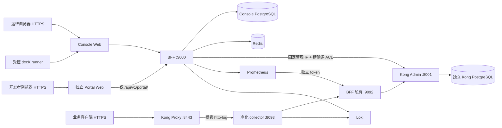

# KongPilot 历史技术参考

此文前 16 节保留早期验收期间的技术契约与历史说明，不作为当前部署或产品状态判断依据；其中 M0–M8 范围、SQL 范围、运行版本和“后续研究”均属于历史状态。当前操作请阅读 [部署与运维手册](production-operations-guide.md) 和 [用户使用手册](console-user-guide.md)。M11 诊断合同见本文第 17 节，具体交付状态以 M11 验证记录 为准。

---

# KongPilot M0–M8 生产运维手册

版本：2026-10-12。M8 真实端到端、固定 decK、浏览器、审计、软清理和秘密扫描已经闭环；独立生产项目已实际冷启动，完成受限数据库角色、真实 HTTPS 与四个应用镜像加固扫描。生产 UI 全覆盖、联合备份恢复、容量和基础组件风险验收仍在进行；本文不作为生产验收通过证明。最新结果见 生产验收记录。

本轮范围为 M0–M8。M9 工具箱、M10 治理/漂移/Promote、M11 完整工单能力属于后续研究。M6–M8 已有的审批不能替代尚未交付的 M11 全部工作流要求。

## 1. 部署边界与版本

| 项目 | 仓库当前实现 | 生产操作要求 |
| --- | --- | --- |
| 网关 | `kong:1.5.1`、Kong 专用 PostgreSQL 11 | 保持 1.5.x 白名单；记录真实镜像 digest、维护与漏洞风险 |
| 控制台库 | PostgreSQL 16，独立 `kongos` 数据库 | 迁移 owner 与 `kongos_app` 运行账号分离；备份数据库与加密密钥 |
| Redis | Redis 7、认证、AOF、独立卷 | 私网、容量与持久化监控；恢复后处理旧会话/锁 |
| API | Node 22、多阶段构建、Debian 13 distroless、UID 1000 | 运行时不注入 owner 密码或 bootstrap 密码 |
| Console Web | React 静态产物、固定 Nginx 1.30.5 stable Alpine；UID 101 和 `/tmp` pid/cache | 独立生产项目已启动；完整运行边界和业务验收见阶段报告 |
| Portal | 独立镜像、UID 101、只读根、tmpfs | 独立 HTTPS 域名、独立 Cookie/签名密钥、精确门户代理路径 |
| 监控 | Prometheus 3.3.1、Loki 3.5.0、独立 collector | 完成凭证 enrollment 与受管插件发布，不能仅启动数据源就宣称有 Vitals |
| GitOps | 固定 decK 1.2.4、BFF 适配器 | 无 Admin 网络；短期专用会话、已确认密封计划；删除经回收站 |

依赖版本以当前锁文件和最终镜像为准。Kong 1.5.1、PostgreSQL 11 及其他旧基础镜像的维护状态是实际约束；npm 公告为零不等于这些镜像没有漏洞，也不等于生产商业安全认证。



控制台后端不连接 Kong 数据库；数据库备份由部署运维在受管主机执行。工作区标签是管理视图软隔离，不是 Kong 原生运行时多租户。直连 Admin 的外部写入可以绕过授权、审计和锁，生产必须禁止。

## 2. 主机、容量与文件管理

建议独立 Linux amd64 主机，Docker Engine、支持 `!override` 的 Docker Compose v2（至少 2.24.4），Node 22 LTS 仅用于部署脚本。固定 decK 官方资产为 Linux amd64；其他架构需另行固定构建与验收。校准 NTP：监控归属区间、会话、审批窗口和定时快照依赖真实时间，不能用更改生产时钟测试定时任务。

起步建议 4 vCPU、8 GiB RAM、至少 50 GiB SSD；带生产构建、双集群验收与保留回滚镜像建议 8 vCPU、16 GiB RAM、80–120 GiB SSD。较大可用空间便于冷构建和恢复演练，30 GiB只是宽裕配置建议，不是当前32 GB主机的硬门槛。实际按网关对象数、审计增长、Prometheus series/保留期和 Loki 日志量计算，不把建议写成已测吞吐承诺。

2026-10-11 19:58 UTC 的只读容量与缓存归属核对记录主盘可用 **932,573,184 bytes**，`/dev/shm` 可用 **7,706,644,480 bytes**；Docker 使用 `vfs`。较早的 944,197,632 bytes 已过时。已安装 Node 基础镜像逻辑大小 226,953,768 bytes，旧 API 应用镜像 293,141,279 bytes；这些不是新镜像构建峰值，也不是实际磁盘 allocated 大小。`vfs` 对每个新增层和新容器复制父文件树，`docker load` 还先解包整个归档；归档放在 RAM 不会自动消除主 daemon 的磁盘临时占用。最终构建、冷启动及第三恢复项目的资源预算仍未证明。当前准备任务专用 RAM 构建或独立 daemon 方案，实际启动前验证权限、存储驱动、网络隔离和真实峰值；RAM 环境只作验收，生产数据库必须部署到持久存储。API 与 migrator 共用一个发布镜像，逐项构建与计量，保留固定工具、发布/回滚镜像和已有卷。

回收只针对已证明为本任务所有、无running/stopped容器引用、非发布/回滚资源且`Shared=false/Reclaimable=true`的精确构建cache ID，记录实际回收bytes；后续构建同样只追踪并回收本次新建的过期cache。禁止`system prune`、`image prune`、`volume prune`或按“看起来旧”删除镜像、卷、证据与固定CLI。容量清单中的“reclaimable”不自动授权删除数据卷。

用独立目录保存生产版本和私密材料。目录 0700，`.env` 0600，专用 token/CA/密码目录及文件按进程 UID 配置 0700/0400。`.dockerignore` 排除 `.env*`、`deploy/private`、证据、测试输出、node_modules 和本地产物，仍需检查最终构建 context 与镜像层。私密文件不发到聊天、不进入 Git，不使用 `set -x`、`docker inspect` 全对象或 `docker compose config` 全输出收集证据。

## 3. 空机器初始化与生产 Compose

以下命令是生产/隔离验收主机的执行流程，**本手册编写期间没有执行**。所有命令在固定发布源码目录运行。系统 Docker 安装遵循官方或企业受管仓库，不能以关闭证书验证、随机安装脚本或 host 网络解决网络问题。

```bash
umask 077
install -d -m 700 deploy/private/kongos-production
node deploy/scripts/generate-env.mjs deploy/private/kongos-production/production.env --production --portal-origin https://portal.example.com:19443
chmod 600 deploy/private/kongos-production/production.env
```

生成器仅在目标不存在时用 `wx` 创建文件，独立生成 Kong DB、Console owner/app、Redis、APP、Portal 和 AES 密钥；bootstrap 密码满足大小写/数字/符号策略。它不覆盖已有环境。仓库的`deploy/production.env.example`提供独立项目、镜像、HTTPS Origin、TLS/metrics/public-CA目录和172.30网段参数；它是占位模板，不能直接作为有效秘密文件。生成后用本机受管秘密编辑工具合并模板的非秘密参数，保留新生成的secret，并去掉生成器默认的测试allowlist/旧HTTP端口值：

| 参数 | 生产值/含义 |
| --- | --- |
| `PORTAL_PUBLIC_ORIGINS` | 如`https://portal.example.com:19443`，精确实际公开Origin，不带path/尾斜线 |
| `PUBLIC_ORIGINS` | 如`https://console.example.com:18443`；不同Cookie hostname，OIDC启用前必须设置 |
| `COOKIE_SECURE` | `true`；基础 Compose 保持 `NODE_ENV=production` |
| `COMPOSE_PROJECT_NAME` | 唯一发布项目名；与命令的 `-p` 一致，防止碰到其他卷/网络 |
| `KONGOS_API_IMAGE` / `KONGOS_WEB_IMAGE` / `KONGOS_PORTAL_IMAGE` / `KONGOS_COLLECTOR_IMAGE` | 本次冻结发布tag，最终登记image ID/digest；API与migrator同一镜像 |
| `KONGOS_CONSOLE_TLS_DIRECTORY` / `KONGOS_PORTAL_TLS_DIRECTORY` | 两个独立目录，只读挂载`tls.crt`/`tls.key`，UID101可读取，证书覆盖对应hostname |
| `KONGOS_METRICS_DIRECTORY` | 本项目专用私密材料根目录，与metrics helper的显式目录一致 |
| `KONGOS_CONSOLE_HOSTNAME` / `KONGOS_DECK_CA_DIRECTORY` | runner的真实TLS hostname alias及公开可信CA目录；不挂Console token或TLS私钥 |
| `OUTBOUND_ALLOWED_HOSTS` | 实际 Kong、Prometheus、Loki 等受管主机，最小集合；保留所需内部服务名 |
| `PROTECTED_DESTINATION_HOSTS` | 所有控制面/存储静态接口，特别是 BFF DNS 看不到的独立 Kong DB IP |
| 管理/存储/门户/telemetry subnet 与 IP | 一起调整、无重叠；不得只改子网或只改 BFF 地址 |
| `AUTH_PROVIDERS_JSON` / `AUTH_PROVIDER_ALLOWED_HOSTS` | 可选受管 LDAP/OIDC 配置；没有真实外部 IdP 时保留未联调状态 |

不要把 `.env.example` 占位符当生产秘密，不把 `.env` 当 shell 脚本 `source`。bootstrap 密码只供首次安全登录；迁移不会把改过的账号密码自动改回环境值。首次登录后按产品账号流程变更密码、建立最小权限管理员，检查已存在的账号/会话，而不是重新播种数据库。

生产使用基础 `docker-compose.yml` 和经过审阅的生产 overlays，**不加载** `compose.development.yml`：该文件降为 development、关闭 Secure Cookie，并挂载编译目录。不得把这套挂载作为生产镜像冷启动证据。

仓库已提供`deploy/compose/compose.production.yml`（发布镜像、非root/只读、tmpfs、资源/日志限制及真正TLS入口）、`deploy/compose/compose.production-metrics.yml`（冻结collector image和专用材料挂载）、`deploy/compose/compose.production-gitops.yml`（runner真实TLS hostname/public CA）。生产metrics顺序固定为base → production → metrics → production-metrics；GitOps再追加原`compose.gitops.yml`和`compose.production-gitops.yml`。若使用registry digest覆盖本地image，先构建/推送并核对digest，再启用该覆盖；不要让build tag与最终up引用不同镜像。这些文件已做源码/离线策略核对，独立生产实际启动仍待验收。

```bash
unset DOCKER_HOST DOCKER_CONTEXT DOCKER_TLS DOCKER_TLS_VERIFY DOCKER_CERT_PATH
KOS_PROJECT=kongos-production
KOS_ENV=deploy/private/kongos-production/production.env
KOS_METRICS_DIR=deploy/private/kongos-production/metrics
chmod 0644 deploy/nginx/console-production.conf deploy/nginx/portal-production.conf
dc() { docker --host=unix:///var/run/docker.sock compose -p "$KOS_PROJECT" --env-file "$KOS_ENV" -f docker-compose.yml -f deploy/compose/compose.production.yml "$@"; }
dcm() { dc -f deploy/compose/compose.metrics.yml -f deploy/compose/compose.production-metrics.yml --profile observability "$@"; }
dcgitops() { dcm -f deploy/compose/compose.gitops.yml -f deploy/compose/compose.production-gitops.yml --profile gitops-runner "$@"; }
dc config --quiet
dc build console-api
dc build console-web
dc build portal-web
dcgitops up -d --no-build kong-db kong-migrations kong console-db redis console-migrations console-api console-web portal-web
dcgitops ps -a
```

本地 socket 操作若有继承的远程 Docker 选择器，仅去除 `DOCKER_HOST`、`DOCKER_CONTEXT`、`DOCKER_TLS`、`DOCKER_TLS_VERIFY`、`DOCKER_CERT_PATH`；保留代理、可信 CA、`DOCKER_CONFIG` 与认证，不启动另一套 daemon。

上例计划启用Vitals+GitOps，因此用`dcgitops`完整配置启动**列出的基础服务**，一次建立API telemetry/9092与Console证书hostname alias；显式服务列表不会启动Prom/collector/runner。只启用Vitals用`dcm`，两个功能都不用则基础启动用`dc`。后续新增网络/env/alias需受控应用配置，单纯restart不会更新它们。`production-policy.mjs`的`assertProductionComposition`在RAM验证有效JSON的项目、HTTPS不同hostname、运行身份、挂载和网络；返回`runtimeVerified:false`，不输出Env，也不替代真实握手/端口/镜像检查。

上例的0644只用于两个不含秘密的公开Nginx配置，保证UID101能读取宿主只读绑定；不能对私钥、环境文件、凭证或备份套用这个权限。镜像内主配置已由Dockerfile规范权限，生产挂载的配置仍需单独检查。

启动前把受管签发的Console/Portal完整证书链和私钥放入各自TLS目录，证书SAN匹配公开hostname；按UID101配置目录遍历和只读文件权限。runner publicCA目录须UID1000可读，内容只含`ca.crt`公开信任根。独立验收可用专用CA签发，但客户端/浏览器/runner都必须真实信任并验证hostname，不能用`-k`。模板路径、文件存在和权限不满足时不要启动TLS入口。

构建经过企业/云代理时，给 **API、console-migrations、Console Web、Portal Web 四个 build** 都配置 BuildKit `proxy_ca` secret，令 npm 保持 `--strict-ssl=true`。现有 `managed-build-override.mjs` 只覆盖前三项，不能代替 Portal 的 CA 配置。生产构建 overlay 示意：

```yaml
services:
  console-api:
    build: {secrets: [proxy_ca]}
  console-migrations:
    build: {secrets: [proxy_ca]}
  console-web:
    build: {secrets: [proxy_ca]}
  portal-web:
    build: {secrets: [proxy_ca]}
secrets:
  proxy_ca:
    file: ${KOS_BUILD_CA_FILE:?Set the trusted build CA bundle path}
```

API与migrator共用同一发布镜像，不重复构建不同代码。最终登记所有镜像digest；`*:local`、Node/Postgres/Redis的可变tag不是不可变发布标识。构建信任文件是build secret，不复制进镜像、不关闭TLS，也不复用为运行账号秘密。Root已在tmpfs下载校验Trivy0.75.0/Syft1.54.1、实际version退出0并准备漏洞DB，公开工具证据见`artifacts/planning/production-scan-tool-download.json`；**尚未做任何最终镜像SBOM/扫描**。工具路径、binarySHA和daemon直读命令见生产计划，执行前确认DB时效，不在当前磁盘创建所有镜像tar。`pg_dump`使用对应数据库镜像内部工具，无需装宿主，避免PG11/PG16版本混用。

## 4. 启动顺序、迁移和权限

基础 Compose 依赖顺序：Kong DB healthy → Kong migrations 成功 → Kong healthy；Console DB/Redis healthy → Console migrations 成功 → API ready → Console/Portal healthy。一次性任务 `Exited (0)` 是正常成功，不需要伪装成 running 或追加假 health。

Kong `kong-migrate.sh` 先查看实际迁移状态；只对明确 fresh 状态 bootstrap，升级状态执行 `up/finish`，连接错误不会当空库。Console `node dist/infrastructure/migrate.js` 自动读取 SQL、校验已应用校验值、播种首次账号，并最后执行 `provisionRuntimeRole`。当前 M0–M8 边界为 **000–011**；已应用 SQL 内容不修改。

`console-api` 仅接收 `kongos_app` 的 `DATABASE_URL` 和 `SKIP_MIGRATIONS=true`。owner 密码、`BOOTSTRAP_ADMIN_PASSWORD` 不在 API 运行环境。运行角色必须非 owner、非 superuser、无 BYPASSRLS、无角色继承成员、无 CREATE。迁移完成后再次覆盖以下权限：审计、工作流版本/审批/事件、门户发布证明、投递 attempts、配置快照/计划/历史等固定不可变表，仅 SELECT/INSERT；`schema_migrations` 仅 SELECT。不能为修复 `42501` 直接给不可变表 UPDATE 权限，应修正查询只锁可变父行。

权限精确以`provisionRuntimeRole`为准：runtime角色LOGIN、NOSUPERUSER/NOCREATEDB/NOCREATEROLE/NOINHERIT/NOREPLICATION/NOBYPASSRLS，无成员继承；数据库CONNECT、public schema USAGE而无CREATE、sequence USAGE/SELECT。普通可变表可有SELECT/INSERT/UPDATE/DELETE；固定不可变表在宽grant之后撤销UPDATE/DELETE/TRUNCATE/REFERENCES/TRIGGER，实际七项检查应为SELECT/INSERT=true、其余五项=false，而不是宣称所有业务表都不可修改。当前固定名单如下，执行时仍核对最终冻结源码；`schema_migrations`另仅SELECT、INSERT也必须false：

```text
audit_events, workflow_definition_versions, workflow_definition_stages,
workflow_versions, workflow_approvals, workflow_events,
portal_publication_revisions, portal_publication_proofs, portal_content_revisions,
portal_failed_issue_abandonments, audit_event_scopes, event_records,
notification_channel_versions, event_subscription_versions,
user_notification_subscription_versions, event_delivery_attempts,
event_detection_observations, configuration_job_pages, configuration_staged_objects,
configuration_staged_collections, config_snapshot_versions, config_snapshot_collections,
config_snapshot_objects, configuration_plan_versions, configuration_plan_objects,
configuration_job_attempts, configuration_gitops_runs,
config_snapshot_schedule_versions, configuration_imports
```

上线前记录 SQL 校验值、applied_at、bootstrap 用户 UUID、不可变表的七项权限和 actual runtime role 属性。正常 API readiness 只验证 Console DB/Redis 可用；它不证明 Kong 数据源健康或真实代理可用，还要在有权限的 UI 检查各集群探测。

## 5. HTTPS、域名和响应头

使用三个独立域名：Console、Portal、业务 API。基础开发端口为loopback Console8080、Portal8082、KongHTTP8000；生产overlay把两个Web替换成**容器8443真实TLS**，模板分别发布loopback18443/19443，公开Origin必须包含实际端口或受管入口的443。`console-production.conf`/`portal-production.conf`读取各自`/run/kongos-tls/tls.crt`和`tls.key`、启用TLS1.2/1.3；8080只提供`/healthz`，其他路径404，不是绕过TLS的入口。TLS目录/私钥需UID101可读且不可写，公开CA不等于私钥。Admin8001永不发布。基础Kong监听内部`8443 ssl`，生产默认不发布宿主8443；业务TLS按实际负载均衡/精确映射接入，通过Console安装有效证书/SNI。

OAuth2 等依赖真实 HTTPS 的插件必须收到 Kong TLS 请求。仅在 HTTP 请求上伪造 `X-Forwarded-Proto` 不等同启用 HTTPS。采用双层 TLS 时，入口到 Kong 8443 也验证 CA、SNI/hostname；Kong 默认证书不能当业务域名证书。

仓库生产方案在两个Web自身终止真实TLS，再以内部HTTP转到BFF；因此`X-Forwarded-Proto $scheme`来自实际HTTPS，`TRUST_PROXY=1`匹配这一层。外层ingress可用TLS passthrough或再次以受信CA/正确SNI连接Web8443，不把HTTP上硬写XFP当TLS。Nginx把XFF替换成直接peer，外层存在时API看到的源IP和限流粒度也会改变；若要保留真实源IP，只从受管ingress接受转发头，并对真实链另行冻结/测试。检查精确PUBLIC_ORIGINS、Host含端口、登录/CSRF/OIDC callback/Secure Cookie，禁止信任公网任选XFF。

Console 代理拒绝 `/api/v1/portal/`；Portal 仅代理 `/api/v1/portal/`，其余 `/api`、Swagger、scrape/catalog/ingest/metrics/Admin 路径 404。Portal 的私有 `portal-edge` 只有 API+Portal；对外 `portal-entry` 只有 Portal，API不加入。共享主域的 Cookie path 不能代替独立门户认证，因此保持独立 host、PORTAL_SECRET、会话与 CSRF。

实际HTTPS验收检查：CSP、DENY frame、单一`nosniff`、Referrer/Permissions Policy、Cookie Secure/HttpOnly/合适SameSite、敏感下载`no-store`。Console `/api/`隐藏upstream `X-Content-Type-Options`，由edge添加单一nosniff；不要重新引入`nosniff,nosniff`。两个生产TLS配置已设HSTS `max-age=31536000`，未启用includeSubDomains/preload；改变前确认域名及全部子域实际支持HTTPS。CSP当前允许样式`unsafe-inline`，这是Ant Design运行样式现状，不宣称完全无内联。这些头仍需在最终实际镜像/HTTPS响应上核验。

## 6. Admin 隔离与新增集群

基础默认Kong管理网为`172.28.11.0/24`、存储网为`172.28.21.0/24`；独立`production.env.example`改用`172.30.11.0/24`和`172.30.21.0/24`，Kong/BFF/数据库仍按模板固定接口。实际使用前查冲突并一起替换。安全启动脚本只监听管理IPv4与loopback，按顺序生成`allow <exact BFF IP>; deny all;`；loopback虽监听但被ACL拒绝。没有允许整个子网或信任伪造XFF的real-IP规则。

API不连接Kong存储网，Web/Portal/Prometheus/collector不连接Admin网。授权之外还要防止 Service.host、Target、普通日志插件把网关 Proxy 变成控制面通道；登记所有 Admin、BFF、数据库、collector/Portal 的固定接口到保护集合。实际测试同时检查正常 BFF Admin200、Kong self-proxy/XFF spoof403、Web/Portal到数据库端口不可达，不能只以 DNS 无解析声称 TCP 隔离成功。

接入远端集群步骤：在网络层预先限定 BFF 出站与远端 Admin 源 ACL → 将准确主机加入受管 OUTBOUND_ALLOWED_HOSTS/保护集 → 在 Console 登记当前 Kong 1.5.x Admin URL及环境/执行模式 → 查看 version/plugins/schema探测 → 创建工作区/最小角色 → 用业务代理验证。远端管理跨机器时使用真实 TLS/mTLS入口或受管隧道，禁止公网裸8001。注册重复物理端点会拒绝；遗留别名共享 physical transport lock/rate，不能用新CID绕过未知状态。

OSS不提供原生工作区/RBAC/Vault/Enterprise hooks；本控制台不调用 `/clustering`、`/vaults`、`/keys`、`/event-hooks`、新版插件 schema 或企业端点。已有root响应无 `endpoints` 的真实限制采用已验证1.5白名单处理。禁止为了“连通”放宽任意代理路径。

## 7. Vitals、Prometheus与Loki

启用 observability profile只启动数据源。完整采集按 M5部署说明 分步执行：登记真实集群CID → 四用途 enrollment → 生成私有Prom/collector目录 → 校验0400/UID1000 → 用 `compose.metrics.yml` 启动内部9092/9093 → 通过有权限的Console发布原生Prometheus与受管http-log插件 → 真实流量与原始查询同窗核验。

四用途严格分离：`native_scrape`/`collector_catalog` audience=bff；`collector_scrape`/`collector_ingest` audience=collector。raw ingest 只进可信 JSON stdin、Console加密库和受管原生插件；生产不生成 test-private-reference、不把它落宿主token文件。Bridge只绑定telemetry API固定IP9092，通过专用 token 验证，不复用主API cookie/JWT。Prom/collector不加入Admin/存储网络；`metrics-bff` 是telemetry-only DNS alias。

基础telemetry默认`172.28.31.0/24`，生产模板为`172.30.31.0/24`：API`.10`、Prom`.20`、collector`.30`。生产collector另有proxy`.51.30`/observability`.52.30`两个固定接口；三个地址由metrics overlay组成`COLLECTOR_SELF_IPS`并进入保护集合。换网段时完整更新地址和DNS身份，不把普通业务地址当collector。

`enroll-metrics.mjs`和`prepare-metrics-storage.mjs`已实现显式生产模式：必须同时给`--production --project --env-file --metrics-directory --output`，生产拒绝旧默认项目、multicluster/test-private-reference及已有output覆盖。内部精确加载base → production → metrics → production-metrics四文件，使用本地socket且只清理冲突Docker selectors；有效config仅留RAM，验证真实项目、只读材料及production-policy，解析该项目实际非external Prom卷，storage helper复用冻结API image中的Node。配置合格返回`runtimeVerified:false`，不是运行验收。开发默认选择器/路径保持兼容，生产不使用`stage-deploy`或旧`rotate-metrics.mjs`的开发默认入口。

先以完整四文件配置启动API及其基础依赖，完成健康1.5集群登记，再执行以下命令；`--discover`只选择健康且已探测到Prometheus能力的物理节点，也可显式`--cluster=<UUID>`：

```bash
set -eu
KOS_RUN_ID="$(date -u +%Y%m%dT%H%M%SZ)-$(node -e 'process.stdout.write(require("node:crypto").randomUUID())')"
test ! -e "artifacts/Production/$KOS_RUN_ID"
install -d -m 700 "artifacts/Production/$KOS_RUN_ID"
node deploy/scripts/enroll-metrics.mjs --production --project "$KOS_PROJECT" --env-file "$KOS_ENV" --metrics-directory "$KOS_METRICS_DIR" --output "artifacts/Production/$KOS_RUN_ID/metrics-enrollment.json" --discover
node deploy/scripts/prepare-metrics-storage.mjs --production --project "$KOS_PROJECT" --env-file "$KOS_ENV" --metrics-directory "$KOS_METRICS_DIR" --output "artifacts/Production/$KOS_RUN_ID/metrics-storage.json"
dcm build telemetry-collector
dcm up -d --no-build prometheus loki telemetry-collector
```

输出证据路径每次用唯一run-id，已有结果拒绝覆盖。enrollment的可信CLI只接收`{"action":"status","clusterId":"<UUID>"}`或`{clusterId,generation,credentials:[{purpose,audience,token}]}`、输入≤8192bytes；SHA256取UTF-8 bearer字串。四token在RAM生成，raw ingest只经stdin到加密DB、不落宿主文件，公开仅安全CID/代数/指纹。现有健康家庭核对本地manifest/指纹/generation后复用，不无谓换钥。正式轮换可在同生产参数上显式加`--rotate-confirmed --cluster=<UUID>`及新的output，之后用固定内部目标校验/reload Prom配置并通过产品重新发布受管collector配置，不能仅enroll就宣称采集已恢复。

Prometheus默认8天/1GiB TSDB保留，不是生产容量承诺。UID1000必须能写自己的TSDB卷，不能放宽token0400；需要迁移所有权时，只挂载准确命名的Prom卷，停Prom、network none/只读helper根/仅CAP_CHOWN，不挂Kong/Console/Redis卷。Loki当前 `auth_enabled:false`、本地文件系统和replication_factor1，只适合严格受管私网单节点，不能暴露公网；跨机接入加认证/TLS并独立验收。

collector只保存/发送最小已验证统计DTO，原始URI/query/header/body/credential不进入Loki。Consumer TopN是近似：重复/丢失/重启counter reset有边界，不宣称exactly-once。未知延迟/带宽保持缺失；Kong1.5原始byte字符串仅在两个指定字段转换。Loki按实际采样网格向内对齐窗口；Prom原生直方图与Loki经验分位数不可混称同一计算法。

开发`compose.metrics.yml`仍有collector宿主源码bind；仓库`compose.production-metrics.yml`已用`!override`移除此挂载，仅保留`KONGOS_METRICS_DIRECTORY/collector:/run/kongos-metrics:ro`，通过collector Dockerfile复制实际`.mjs`、以node/UID1000运行。最终登记`KONGOS_COLLECTOR_IMAGE`的image ID/digest和源SHA，实际检查只读根/无源码bind/三个受限网络；不能用开发bind或缓存Node镜像代替冻结collector运行证据。当前仅源码/离线配置已验证，独立生产运行仍待执行。

## 8. 通知、日志和审计

事件后台outbox/delivery已实现。生产基础Compose开启delivery，只有显式渠道/订阅、当前creator+channel creator授权和可用provider才投递。Webhook/Slack/飞书仅HTTPS、精确 `host:port` 的 `EVENT_DELIVERY_ALLOWED_HOSTS`；URL不含query/userinfo、DNS全部地址验证并pin、redirect拒绝。没有外部账号配置则显示 unavailable，不把本地receiver等同外部邮件/Slack/飞书联调。

SMTP固定operator host/port/servername/from，可用implicit TLS或强制STARTTLS。`EVENT_SMTP_PASSWORD_FILE`、CA文件需在API只读挂载；TLS前后、AUTH前/DATA前重新核验权限/lease/generation，证书验证与TLS1.2下限保留。只配置allowlist不代表已有渠道。测试 `compose.notifications-test.yml` 与本地收件器不是生产外部渠道，生产不加载其profile/控制socket/测试秘密。

投递是至少一次；有durable send-intent但ACK丢失时必须uncertain，不能自动声称远端未收到。人工replay查看最后immutable attempt，权限撤销/unknown不允许靠新key绕过。收件方应按稳定delivery/idempotency key去重。

Console/Kong安全access log不记录query/header/body。原生请求错误可能重复URI秘密，当前Kong和Web error_log默认 `/dev/null`；这牺牲原生错误诊断，保留BFF安全错误码/requestId、status/timing及进程启动日志。未经验证的原始error sink不能随意开启。生产为Docker日志设置明确轮转与中央收集配额，导出前脱敏，禁止整段Config.Env与原始provider响应。

审计表与attempt表运行权限仅追加/查询。审计链检测内容/hash/序号/链头，但DB超级用户仍可控制数据；定期把每条链scope、sequence、head hash、UTC时间、发布digest和前一个checkpoint摘要签名，发送到**独立权限的WORM/对象锁存储**。仓库当前没有自动外部checkpoint发布器，须配置运营作业并实测，不能承诺已有外部防篡改服务。审计验证接口为集群 `/api/v1/clusters/:cid/audit/integrity` 与全局 `/api/v1/audit/global/integrity`；处理partial与nextCursor，不能只查第一页报complete。导出需独立权限、原幂等回执和受保护下载。

当前未实现可任意删除immutable审计历史的在线保留任务。容量管理先扩展/归档/WORM策略，不能直接DELETE/TRUNCATE或改grant，不能改写旧失败记录来补完整审计。

## 9. 快照、GitOps与未知变更

快照是Console加密保存的完整有界对象图，不能替代数据库备份或OAuth活跃token库。capture超出分页/字节预算须失败，不伪称完整。导出含凭证/私钥时是秘密文件；禁止提交明文完整YAML到普通Git，使用受管加密存储或先用产品脱敏导出。redacted文件不能当可完整恢复的凭证备份。

配置执行按当前版本、插件集、schema、planRevision/planHash、baseline HMAC、当前SID/grants与集群模式检查。回滚也生成diff/计划/审批/执行前快照；不会跳过回收站。Kong1.5 string `len_min` 懒补等价只是已验证的窄兼容规则，其他schema约束差异仍阻止执行。

GitOps使用 `deploy/compose/compose.gitops.yml` profile，固定二进制SHA `642f49fd64e83aff867939705dbd927c5e750b241a99e8539ab22d18930427ed`、版本1.2.4/8e68931，analytics off、verbose0、parallelism1、TLS验证开启。runner仅frontend、UID1000、只读/noexec tmpfs、无Admin/DB/socket/host端口。

生产再加载`deploy/compose/compose.production-gitops.yml`：Console的frontend alias为`KONGOS_CONSOLE_HOSTNAME`，必须在实际证书SAN中；runner固定访问`https://<hostname>:8443`而非宿主18443，`SSL_CERT_FILE=/run/kongos-deck-ca/ca.crt`来自独立公开CA只读目录。该挂载没有Console密码/token/TLS私钥。用前述`dcgitops build console-deck-runner`构建并固定最终digest，实际业务runner作为受控stdin单次任务运行，不常驻伪造空任务。构建proxy CA与运行public CA分开；禁止TLS skip或用HTTP hostname绕过证书。

专用会话由受授权Console身份在 `/api/v1/clusters/:cid/configuration/deck-sessions` 申请，短期绑定job/scope/计划。runner JSON stdin键为 `command,sessionId,tokenSecret,stateYaml`；秘密不放argv/env，输入文件0600/目录0700、使用后删除。协议入口 `/api/v1/deck/:sessionId` 不接受通用反向代理。CLI全局凭证读取在BFF按授权Consumer转嵌套分页。原CLI BasicAuth密码diff限制保留；只能用实际代理认证证明密码仍可用。

`validate`仅证明文件格式；CLI exit0不等于job成功。`sync`额外packet、变化plan、会话过期/撤权必须拒绝；真实删除经Recycle。Target update可对已密封精确pair投影逻辑旧ID，普通读回仍用实际effective ID，不能泛称历史UUID复活。

未知/超时操作保留original key/job/plan/receipt，先只读核对；不自动换key重复。请求失败可能已commit，下载也可能已消费许可。只在证明确为knownfailed/no native并通过对应产品恢复/新intent规则后接续。不得SQL改job状态或临时放宽schema/权限。

## 10. 备份与联合恢复

至少备份：Console PG全库、Kong PG每个物理集群、Redis AOF/备份、三个根秘密与部署环境、metrics私有目录/对应generation、通知SMTP/渠道相关部署材料、TLS/CA及SNI证书管理资料、发布镜像digest与SQL/源码SHA、外部审计checkpoint。Prom/Loki持久卷按监控保留要求备份。ConsoleAES key丢失后，DB中的凭证、快照/回收站、导出材料无法解密；仅有数据库dump不够。

一致性恢复点流程：创建变更/恢复记录 → 冻结配置写入、审批执行、定时快照/事件worker，停止API进程避免后台写 → 暂停或切走Kong代理流量（OAuth等会写Kong DB）→ 数据库可读期间完成各库dump → 记录各库checkpoint/时间/校验值与当前generation → 对稳定Redis/监控卷使用平台快照 → 加密离机备份 → 恢复服务并验证。两次独立在线dump不能宣称Console+Kong分布式同一事务备份。

批准维护窗口后的逻辑dump示例；`dc`必须指向这个生产项目。DB操作来自部署运维，不是BFF：

```bash
umask 077
KOS_BACKUP=/secure-backups/kongos/restore-point-YYYYMMDDTHHMMSSZ
install -d -m 700 "$KOS_BACKUP"
dc stop console-api
# 先在受管入口暂停业务流量，确认配置/凭证写入已经停住。
dc exec -T console-db pg_dump -U kongos -d kongos -Fc > "$KOS_BACKUP/console.dump"
dc exec -T kong-db pg_dump -U kong -d kong -Fc > "$KOS_BACKUP/kong-primary.dump"
dc exec -T console-db pg_dumpall -U kongos --globals-only > "$KOS_BACKUP/console-globals.sql"
sha256sum "$KOS_BACKUP/console.dump" "$KOS_BACKUP/kong-primary.dump" > "$KOS_BACKUP/database.sha256"
```

另一个Kong数据库逐库备份，不能用主库代替。globals包含角色秘密，dump包含原生凭证/私钥，全部视为私密并使用企业加密备份工具（独立恢复钥匙）加密后离机。不要把裸dump/完整manifest发布到artifacts。备份退出码、文件存在/尺寸/hash和恢复实测分别记录。PostgreSQL物理/WAL备份只能按对应PG11/PG16版本和平台流程使用，不把运行中的数据目录简单复制当一致备份。

恢复先在独立项目/新卷演练，固定原数据库major、原应用digest、原AES key、必要APP/Portal secrets，不覆盖生产卷。先DB角色/库、Console与各Kong库，再Redis/私密材料，最后迁移权限校验与API/网关。新项目emptyDB只允许正式migrations，不用旧开发checker重写状态。对还原后的已有库确认schema校验，再用同一版本migrator `run --rm --no-deps console-migrations` 重设最小运行权限；它不得拿未经批准的更新SQL前推。

```bash
# dc_restore 是独立恢复项目的完整Compose函数，绝不是生产dc。
dc_restore exec -T console-db pg_restore -U kongos -d kongos --exit-on-error < "$KOS_BACKUP/console.dump"
dc_restore exec -T kong-db pg_restore -U kong -d kong --exit-on-error < "$KOS_BACKUP/kong-primary.dump"
```

恢复Redis旧快照会恢复旧sid/锁/撤销信息。默认灾后让所有Console/Portal用户重新登录，按正式账号/会话撤销流程失效旧会话；不以“Redis可丢”跳过撤销验证。旧lease/intent由生产worker按durable SQL恢复并保留uncertain，不手工删除SQL证据/盲发通知。恢复完成后先验证root1.5/version、对象图和真实代理凭证、Portal currentkey轮换/吊销状态、RBAC、审计链与外部checkpoint、metricsgeneration、回收站和快照解密，再开放写入/代理流量。记录实际RPO/RTO；未演练不得标恢复成功。

## 11. 密钥和凭证轮换

| 材料 | 可执行策略与边界 |
| --- | --- |
| 网关/门户业务凭证 | 走授权UI轮换/吊销、审批与幂等回执，真实Proxy验证；旧credential必须失效 |
| metrics四用途家庭 | 新generation同组原子enroll→精确0400文件→Prom config check/reload→授权重新发布受管http-log；旧generation立即失效，存在短暂采集窗口风险 |
| 通知渠道endpoint/auth | 走产品版本/generation；换目标明确认证选择，绝不自动把旧secret发到新host |
| SMTP密码/TLS材料 | operator只读文件原子替换、受控API重建/重载取决于读取生命周期，验证TLS及实际收件；秘密不argv/env打印 |
| DB app/owner或Redis密码 | 在维护窗口分别更新服务端角色/认证和受保护部署配置，再明确recreate相关服务使env生效；只restart不会更新env；核对旧连接撤销 |
| APP_SECRET / PORTAL_SECRET | 签名会话相关，轮换引起现有会话失效；保持独立、不复用AES；先验证当前sid/refresh撤销和门户登录流程 |
| CONSOLE_ENCRYPTION_KEY | **没有可直接运行的全库重加密轮换工具**。它也用于fingerprint/HMAC，不可简单改.env后重启；需专门设计所有AAD上下文、历史HMAC、快照/plan/cipher迁移与rollback，完整隔离恢复验收后才执行 |

metrics轮换中途失败不生成另一组随机键“修好”；先核对原bundle/currentgeneration、本地manifest pending状态，使用同原内容幂等恢复或明确更高generation。生产不使用测试capture脚本输出ingest/rawtoken，也不把密钥备份与数据放在同一权限域。

## 12. 发布、升级和回滚

发布前冻结Git commit、锁文件SHA、SQL000–011、image digest/SBOM/扫描、private材料安全指纹、原容器/固定地址/卷名、审计checkpoint和联合恢复点。禁止同时执行部署与用户写验收；区分系统后台正常catalog刷新和配置/凭证变化，不能把动态遥测timestamp严格冻结后误判，也不能忽略真实cipher/generation变更。

当前基础部署为单节点示例，不宣称zero-downtime或已验证HA。多API副本会改变精确BFF-IP ACL/信任链，必须另行设计，不把管理ACL扩大为子网。Kong1.5之外升级须新的适配/真实协议验收，不仅改image tag。

升级顺序：恢复演练已通过 → 维护窗口/暂停写worker → 构建并扫描最终镜像 → 独立migrator正式迁移 → 用新API/Web/Portal镜像受控recreate → actual health与权限/Proxy抽测 → 恢复worker/流量 → 独立audit/secret扫描。发布镜像变更用 `up --no-build`/精确service recreate；`restart`只重启旧容器，不替换镜像/env。开发bind阶段的“编译然后restart”不能照搬为生产镜像升级。

应用回滚只在旧镜像对当前schema明确兼容时进行。SQL是append-only，不运行未审downgrade、不修改已应用checksum。数据库级回滚会丢弃备份点后业务，必须通过联合恢复与RPO审批。配置回滚使用M8产品diff/计划，不直接执行decK到Admin；回收站purge是明确的物理归档清理，不能用它当普通删除。

## 13. 故障诊断与值班

| 症状 | 先看安全事实 | 正确下一步 |
| --- | --- | --- |
| Web 403/白页 | index/js/css HTTP状态、文件0755/0644、镜像/挂载 | 修构建/公开权限，不能放宽私密目录 |
| API live200/ready503 | DB/Redis health，runtime角色和网络 | 查受控存储/认证；不要把owner密码注入API |
| 登录/CSRF/OIDC失败 | Origin/Host含端口、TLS、Secure Cookie、requestId | 校准受管代理链与精确来源；不关闭CSRF/Origin |
| Kong Admin403 | 请求是否来自对应BFF固定IP、ACL顺序/DNS | 修接口配置；不允许loopback/整个子网 |
| 正常上游403 protected destination | 是否指向Admin/DB/collector/Portal接口 | 保留拒绝，只有真实受管系统路径可走最窄例外 |
| metrics空 | datasource连接与真正接入分开、plugin、generation、catalog blocked、时间窗 | 核对enrollment/合法归属/原始同窗查询，不填零 |
| job500/超时 | original key/receipt、commit/execution/step/Native开始事实 | 只读明确knownfailed/uncertain，再用产品恢复；不重播/SQL改状态 |
| 42501/23514 | 安全SQLSTATE、不可变表权限、revision CAS约束 | 修source/父行锁或CAS；不grant UPDATE/删约束 |
| 通知暂停/unknown | currentcreator/channel creator授权、lease/gen、最后immutable attempt | 重新授予或明确replay规则，不能伪造远端未收 |
| 内存/磁盘告警 | OS/卷/日志/TSDB容量安全计数 | 扩容或精确回收已证明无引用的自有构建缓存；不broad prune |
| audit mismatch | 第一错误序号/hash、外部checkpoint、DB角色 | 立即保留证据、限制写入、调查；不改历史匹配新hash |

健康端点：Console/Portal `/healthz`，BFF `/api/v1/health/live`、`/api/v1/health/ready`，BFF自身metrics `/api/v1/metrics`。自身metrics是公开主API端点，生产ingress按运营策略限制或只内网采集；不是独立9092 gateway bridge。Swagger `/api/docs-json` 同样应在生产ingress限制授权网络，不让Portal代理它。

值班证据仅保留服务名、状态、request/job UUID、安全错误码、时间、hash/计数。provider URL/query、Authorization、SMTP AUTH、Cookie、密码、PEM、dump/YAML原文不得进工单、截图、日志或公开验收。保留原失败和改进后报告，不能把源码test、isolatedPG、mock、镜像启动与真实业务验收混为一项。

## 14. 生产出口清单

上线需同时有最终M8闭环、生产冷启动、所有实际镜像/SBOM扫描与处置、非root/网络边界、原凭证/Portal真实恢复、审计checkpoint、负载与容量、备份RPO/RTO、外部provider实测或明确未配置状态。现有stage脚本会固定开发project、证据路径与测试操作，不能不审阅直接指向生产；部分verify-only还包含预期拒绝的边界POST/零行DELETE，不应宣传全是GET。

仓库现已提供非root Console Dockerfile、两个真实8443TLS配置、三生产overlays、独立production.env模板、production-policy和参数化enrollment/TSDB helpers；这些属于源码交付。未完成事项仍包括最终无开发bind镜像冷启动、真实UID/TLS/网络与collector/runner实际验证、协调snapshot/备份恢复RPO/RTO、外部checkpoint实施、最终镜像SBOM/漏洞处置和实际容量/故障结果；根AES全库轮换工具、外部LDAP/OIDC/SMTP/Slack/飞书未联调限制保持。最终API源码/编译数量以M8结束后的freeze为准，本文不把此前219JS或正在修复的binder当最终发布版本。逐项形成真实证据后，才能作对应范围的生产就绪结论。

## 15. 本机低磁盘下的独立 RAM 验收方案（历史准备记录）

本节保留实施前的准备记录；实际结果见第 16 节。本节只描述当前32 GB实验宿主的替代验收路径，不改变前述持久化生产部署。现役daemon为`vfs`，最终镜像load和新容器都可能复制完整父rootfs；把tar放到RAM不能避免主daemon的解包与复制。因此拟在**一个新任务工具容器**中运行独立daemon，把最终镜像构建、独立生产项目、第三恢复项目全部留在该daemon，避免向现役daemon反复load。当前UID1000无sudo，不能声称已在宿主成功启动daemon；工具容器的特权、overlay2可用性、资源限制和网络边界都待后续实际窗口证明。应用容器仍按生产Compose非root/只读/最小权限运行，工具容器的临时特权不是应用生产配置。

工具容器仅加入新建任务build网络，不加入现役Admin/storage/Portal/metrics网络，不挂现役Docker或containerd socket，不共享宿主PID/network。Docker、dockerd、containerd、runc、docker-proxy与Compose插件只挂已核SHA的公开静态工具；不挂HOME、宿主Docker认证配置或npm私有配置。主daemon仅承担这一个工具容器，其新RW层仍可能复制完整Node父文件系统。创建前必须量化实际分配上界，并在主盘保留**250 MiB业务写入储备**；Node image的226,953,768 B逻辑Size不是分配上界。无法证明则停在容量阻断，不清理现役镜像或卷。

不能把整个仓库目录挂入工具容器。先按最终源码freeze与Dockerfile依赖白名单，复制公开package/lock、三个应用源码与公开构建配置、contracts、指定Dockerfile/生产Compose/Nginx/deploy helper到任务RAM目录，再在工具容器映射为同绝对路径。逐文件拒绝symlink逃逸；排除所有旧`.env*`私密文件、`deploy/private`、`.git`、artifacts、日志、旧dist及测试fixture。仅允许公开example模板；私有生产env、TLS key、metrics与恢复材料使用本次新0700目录/0600或0400文件，位于context之外。helpers如需依赖，可单独挂经过路径检查的纯`node_modules`只读目录，不能借workspace链接把旧目录带入。

工具容器内`/var/run/docker.sock`必须是新daemon的socket；外部客户端只使用新socket的绝对路径。`enroll-metrics.mjs`、`prepare-metrics-storage.mjs`和production命令草案固定使用`unix:///var/run/docker.sock`，因此**在工具容器内运行**，不修改冻结helpers，也不在宿主仅设置DOCKER_HOST后直接运行它们。新daemon使用独立data-root/exec-root/pid/containerd状态，且其`TMPDIR`明确位于受限RAM data-root；load的归档解包不能落回工具容器主盘`/tmp`。client配置、exec/run、日志和工具`/tmp`也只写有界RAM位置。Compose插件版本和socket归属需核对；默认bridge/iptables方案要在工具容器独立network namespace中实际验证。overlay2只有实测成功后采用；若只能用vfs，按完整层及新容器复制重新预算，不保证能容纳。

RAM暂拟上限分配：daemon数据5 GiB、单个公开image归档512 MiB、私有备份流512 MiB、公开context32 MiB、exec/报告/剩余储备512 MiB，共7,012,876,288 B。此前只读观察可用7,706,644,480 B，说明该分区草案可进入验证，**不说明构建/运行实际峰值够用**。已有scanner/DB缓存保持；正式每阶段重核RAM、进程内存/cgroup与磁盘，归档和备份流都设硬字节上限，逐镜像构建并记录峰值。越界或overlay挂载失败就停止，不用额外daemon绕过限制，不做broad prune。

公开基础镜像可从现役daemon按准确ID一次一个导出到有界RAM归档，再load进新daemon并核ID/diffIDs；只删除本次临时公开归档。最终API与migrator共用一个真实镜像，Web/Portal/collector按原Dockerfile顺序构建，无源码/dist bind替代品；固定runner可准确复用。fresh和restore使用不同project、独立网段/卷/env/端口，同一组冻结镜像。所有生产Compose与私密材料bind源路径在工具容器namespace内实际可见，不能把宿主路径不存在的volume当启动成功。

浏览器入口拟用固定TCP透传：fresh Console/Portal宿主127.0.0.1:18443/19443，工具端28443/29443，再到新daemon发布的localhost18443/19443；restore另用21443/22443和工具端31443/32443。透传不终止TLS，不改Host/XFP、不提供任意目的地或管理端口；独立域名/SAN/公开CA与安全Cookie照常验证。该透传程序尚未实现或运行，需固定配置、负例及实际双TLS证据。不能把HTTP转HTTPS标头当真实TLS。

联合备份只暂停新项目的写入/代理/collector，按PG16/PG11匹配工具和Redis稳定窗口导出；APP/AES/Portal、TLS与metrics代次一并加密备份。备份必须使用认证加密、独立恢复钥匙，写入新0600 wx持久文件或另行获授权的外部备份目的地并核hash后，才允许清理RAM。磁盘还要同时保留工具容器占用、250 MiB储备和实际加密备份字节；不能因RAM够就宣称离机备份容量够。第三项目恢复不重enroll/rotate、不分享卷，旧session/定时任务/外部provider先隔离，再由唯一验收owner做解密、代理凭证、审计及RPO/RTO实测。

最终SBOM/CVE针对新daemon的准确最终image ID执行，不能误扫现役development镜像。清理仅本次任务daemon精确PID、任务工具容器/build网络/RAM目录与被批准的验收项目资源；先保存镜像摘要、公开证据和离RAM的可恢复备份，现役22容器、回滚镜像与所有卷保持。未获发布授权不推送registry。RAM数据库只是资源受限下的验收实验，商业生产必须采用持久盘/受管数据库与实际备份策略，本方案不证明RAM数据库有生产持久性。具体SOURCE边界见独立RAM daemon准备记录。


## 16. 实际生产镜像验收更新（2026-10-12）

四个最终应用镜像已实际构建并由 Trivy 扫描，严重/高危漏洞和镜像秘密命中均为零，已生成 CycloneDX SBOM。证据为 `artifacts/Production/root-production-security-runtime-v4-build.json`、`root-production-security-runtime-v4-scan.json` 和 `root-production-final-application-sboms.json`。这是四个应用镜像的结果；Kong 1.5.1、PG11、其他存储/观测组件及固定 decK 的风险单独记录，不能外推为整套系统零漏洞。

API 和 collector 的 distroless 运行镜像没有 Shell、npm 或系统包管理器。检查使用 Docker `inspect`、现有 healthcheck、结构化日志及 `docker exec <API容器> node -e '<只读检查>'`；不能再执行 `docker exec <API容器> sh` 或现场安装调试包。迁移仍由同一 API 镜像的一次性 Node 任务执行。

本次使用独立 RAM Docker daemon 完成实验验收，未触碰原开发环境数据库和 Admin 网络。RAM 容器、数据卷和 TLS 不能作为持久生产部署。上线必须使用持久磁盘，保存不可变发布镜像、经认证加密的联合备份及独立受控恢复密钥，执行实际恢复演练。当前外部备份存储和业务 SLA 均未验证。


升级已经启用 metrics overlay 的项目时，始终使用原项目完整的四个 Compose 文件：`docker-compose.yml`、`deploy/compose/compose.production.yml`、`deploy/compose/compose.metrics.yml`、`deploy/compose/compose.production-metrics.yml`。即使仅更新 API/Web，省略后两个文件也会改变已运行项目的网络与环境声明，不能作为升级命令。本次已实测完整 overlay 启动；不完整 overlay 的失败报告保留。更新前先保存精确镜像摘要、完整启动文件顺序与私密环境副本；不要删除数据卷或运行全局 prune。

历史基础组件的实际漏洞及上线门槛见 生产风险登记。应用镜像零高危/严重不代表整个系统的商业安全门槛通过。

### 首次启用 Prometheus 的卷权限

`prepare-metrics-storage.mjs` 会先创建本项目的 Prometheus 容器而不启动进程，使 Docker 完成首次目录复制，再把唯一 TSDB 卷的属主设为运行用户 1000:1000。仅在空卷上提前 chown，可能被首次挂载从镜像复制的属主覆盖，导致 `/prometheus/queries.active` 权限拒绝。实际失败日志、修复后的卷准备和健康状态分别保存；不能以 Compose 命令成功代替容器健康。

### PostgreSQL 逻辑恢复的会话搜索路径

本项目历史校验函数在正常 `pg_catalog,public` 搜索路径下调用其他同 schema 函数。`pg_restore` 生成的脚本默认把 `search_path` 清空，会令这类调用进入异常分支而触发 CHECK 拒绝。恢复助手先验证原加密归档和 dump 校验和，用数据库匹配版本生成私有 SQL，只替换前 4096 字节内唯一的标准搜索路径 prologue，再通过 `psql --single-transaction --set ON_ERROR_STOP=on` 导入。所有数据、约束、函数及审计哈希保持原内容；不使用禁用约束或改写历史行的方法。SQL 包含凭证，仅在私有内存/标准输入中处理，不能输出到日志或普通文件。旧失败副本仅存在于隔离恢复项目，复验从已证明为空的目标库开始，原生产库和备份不覆盖。

### 最终版本与阶段结论

最终 API 镜像为 sec7，包含 Route 下钻和门户应用事务内审计修复；Web 使用 sec5，Portal 与 collector 使用未变更的 sec4。实际摘要、6290 项全量测试、178 项浏览器操作、联合备份及恢复证据见 阶段验证。工作区已有完整镜像归档与经认证加密的恢复点；恢复点按备份时 sec6 版本先恢复，再经相同 SQL000–011 校验升级至最终 sec7，已实际验证原凭证和审计链。任何新的生产站点应采用受管持久数据库/磁盘、企业 TLS、外部备份及漏洞处置流程。本实验不能作为现成的持久商业生产站点。


## 17. M11 技术运维补充（2026-10-15）

本节补充当前源码合同，不宣称 M11 整体验收或商用通过。正式升级、迁移清单与生产交接以 [部署手册第 19 节](production-operations-guide.md#19-m11审批政策与实体工单运维) 为准；页面入口以 [用户手册第 23 节](console-user-guide.md#23-m11变更工单独立审批与恢复基线) 为准。

### 固定业务工单与授权边界

| 工单类型 | 固定业务 | 原生写入边界 |
| --- | --- | --- |
| `native-change` | 核心实体、凭证、Target、回收/恢复与新回滚意图 | 仅封存的实际包、依赖、schema、当前授权及真实来源 |
| `control-metadata` | 集群、数据源、工作区登记元数据 | 零 Kong 原生写入；不能扩大为通用代理或默认工作区授权 |
| `iam-metadata` | 用户、团队、角色、成员与权限绑定 | 零 Kong 原生写入；可委派范围及权限版本变化仍需实际核验 |
| `metrics-setup` | 平台监控设置及受管全局插件 | 包含真实插件写入，要求有效数据源、部署 enrollment 与当前代次 |
| `entity-annotation` | 负责人、说明与扩展元数据 | 零 Kong 原生写入；仍须真实实体关系、当前范围与说明版本 |

工单类型与 handler 由后端固定注册，前端不能选择任意 SQL、原生路径或执行句柄。控制面工单可能存放在有效锚点工作区，但实际目标仍由封存记录与当前目标授权判断；URL 中的工作区选择器不是默认范围许可。终态最小原回执不恢复已撤销的授权。

M11 控制面、IAM、监控设置和说明工单可能要求原 authoring session；读取、投票、执行与终态回执各自按当前资格和原事实核验。新登录不是延期、会话借用或旧工单执行权迁移的机制。身份或工作区创建导致的权限版本变化须来自该次真实事务及精确完成证据，不能伪造 epoch。

### 不可变事实与原键恢复

SQL019 起的政策、意图、来源、发送、结果、观察与完成事实采用追加合同；运行角色不应拥有 UPDATE/DELETE/TRUNCATE。SQL030–036 涵盖 IAM、Target 健康、监控设置、控制面及实体说明合同；SQL034 追加修复控制意图时钟，SQL036 只修正 SQL031 重引入的恢复基线函数别名，不修改历史文件或放宽身份/范围约束。迁移及授权使用正式 migrator，检查全部历史摘要与实际 app 角色，不从管理页面执行 DDL。

原键恢复仅读取对应领域的原事实。实体准备通过 `entity-changes/by-prepare-key/:key`，IAM 通过 `iam/changes/by-key/:key`，控制面通过 `control-changes/by-key/:key`，监控通过 `vitals/setup/intents/by-key/:key`，说明通过 `annotation-changes/by-key/:key`，业务排程命令通过 `workflow-schedules/receipts/by-key/:key`；除全局 IAM 外均位于真实集群 BFF 前缀。使用对应实际 Controller 的查询参数与当前权限，完整路径表见部署手册。

只读结果为未观察到、不存在、超时或拒绝，均不能单独证明原写入未发生。原请求保持未知时，不新建 key 重发、不删除 journal、不改旧 expiry、SID 或批准。不确定原生结果与已认证的元数据尾部失败须分开，只有固定恢复器证明精确来源后才能办理规定的元数据收尾。

Target 即时审批入口使用固定的 create、weight/tags、healthy、unhealthy 和 recycle-delete 业务动作；源代码入口不等于真实运行验收。准备、审阅和 typed-confirm submit 不发送原生写入，未知恢复仅原 prepare/submit key GET；`not_observed` 继续保持未知。

创建时接受目标地址，编辑只接受权重与业务标签，地址锁定；权重为 0–1000 整数。权重 0 和删除需要额外确认，删除先进入回收流程。权重更新使用追加记录语义、新 UUID；原 201 与当前历史被网关清理是独立事实，不能强制旧 ID 等于新 ID。

手动健康须启用健康检查（主动或被动），当前实际 `/health` 行必须同 Target UUID、Upstream、地址和权重，且状态为 HEALTHY/UNHEALTHY。OFF、缺失或异常时不开放。真实成功响应为无正文 204，不能制造实体 JSON；只代表当前 Admin API 节点，观察值无法证明置位前的手动状态，故不自动回滚、不进入定时健康适配器。定时 Target 继续仅接受创建/权重的固定适配器。

### 后台调度与持久恢复

`ENTITY_SCHEDULES_ENABLED` 和 `BUSINESS_SCHEDULES_ENABLED` 默认关闭。启用前按最终版本验证自然 worker、固定委托、当前批准人资格、真实权限版本、原 lease/窗口、单次 claim 和逐包结果。SQL/Redis 续约只能维持所有权，不延长原业务期限。窗口使用 UTC 瞬间的半开区间，界面展示时区不改变其范围。

普通实体定时与业务排程分别管理；后者只接受当前固定适配器及首票前的新计划修订，不允许将有旧票、旧执行或过期计划转换成后台写入。只读治理调度不授予自动发布能力。已知单次竞争或人工调用 tick 不能替代持续多副本和自然计时器验收。

`compose.release-persistent.yml` 是 `NODE_ENV=test` 的验收覆盖文件，不是生产部署入口。Docker named volume 的持久性取决于 daemon 的真实 data-root；RAM/临时工具容器中的卷不能证明主机重启恢复。私密账本、会话或嵌套数据库丢失时，保留旧证据和缺失范围，新 run 使用全新材料；不得重建旧 SID、批准或原请求作为恢复证据。正式生产采用持久数据库、密钥保管、受控加密备份与独立恢复演练。


### 产品手册与历史验证材料

终端用户手册只保留当前页面步骤、能力边界和必要安全提示。历史测试审计缺口及修复范围、隔离候选的用例计数、浏览器只读证明与真实写入证明分别存放阶段报告，不混入日常操作步骤。历史 key-auth/新增插件 Promote 回滚的隔离验证属于 M10 分项证据，不扩展为其他凭证或最终发布版本通过；具体记录见 M10 验证。

M11 新入口和最终版本仍须按 M11 验证记录 逐项验收。即时 Target 审批 UI、真实健康 204、主动/被动检查条件、权重回滚、所有定时适配器和浏览器业务写入各自形成证明；源码测试数量不代替现场运行、完整审计或商用结论。
