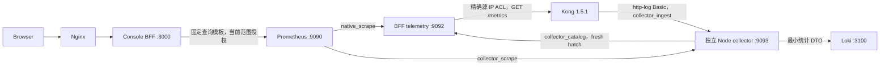

# M5 私有指标与日志采集部署

M5 使用 Kong 1.5.1 自带的 Prometheus 0.6 插件和独立 http-log 采集器。配置检查、单元测试、实际启动、真实流量和图表比对分别留证；配置可解析不代表请求指标已经出现。当前证据目录为 `artifacts/M5`，最终验收以该阶段验证文档为准。



9092 只绑定 telemetry 网络的 API 固定 IPv4，不能通过公网/MainHTTP 获得系统身份。telemetry 网络默认 `172.28.31.0/24`，API `.10`、Prometheus `.20`、collector `.30`，不得与已有管理/数据库网络重叠。Prometheus/collector 不加入 Kong Admin 或任意数据库网络，也没有公开端口。Kong 的两个精确 BFF-IP Admin ACL 保留。

collector 三个接口地址均固定：telemetry `172.28.31.30`、proxy-edge `172.21.0.5`、observability `172.22.0.5`；后两个网络分别在 overlay 显式声明 `172.21.0.0/16` 与 `172.22.0.0/16`。如环境网段冲突，应同时调整网段及对应接口地址，配置检查拒绝已声明网段重叠。API 的 `COLLECTOR_SELF_IPS` 与 `PROTECTED_DESTINATION_HOSTS` 由相同三项地址配置生成，普通 Service、Target 和日志插件始终拒绝所有采集器接口地址。受控监控发布额外要求 telemetry-only `metrics-collector` 精确解析为 `.31.30`，且 `telemetry-collector` 的所有 DNS 结果属于这三个真实接口，不接受其他普通业务地址或管理/数据库地址。

首次把原 Docker 自动分配网段转为显式 IPAM 时，Compose 网络配置哈希会改变。当前修复沿用原网段及采集器地址，但仍须短暂停止并重建这两个网络的现有连接服务：Kong/C2/echo、API、Prometheus/Loki/collector；控制台数据库、两个 Kong 数据库、Redis 与全部持久卷保留，监控密钥不重新注册或轮换。该过渡单独留证，最终核验三个实际接口、DNS、原卷挂载、generation 与 Admin ACL。

`deploy/compose/compose.metrics.yml` 是可选 overlay；API 本体、Kong 和所有持久卷保持原部署。采集器使用已固定的 Node22 镜像和只读源文件，生产 Dockerfile 在 `deploy/metrics-collector/Dockerfile`。Prometheus/collector 非 root、删除全部 capabilities、只读根文件系统，临时文件只在 tmpfs；只有 Prometheus 原 TSDB 数据卷可写。

## 首次注册和启动

先启动基础部署并完成集群注册/探测及控制台 migration；此后通过可信本地命令注册采集凭证。全局 SQL seed 不猜测随机 clusterId，也不产生采集秘密。

阶段开发使用：

```sh
node deploy/scripts/stage-deploy.mjs M5 --multicluster --observability --dry-run
node deploy/scripts/stage-deploy.mjs M5 --multicluster --observability
```

第二条由阶段负责人统一执行，依次编译、迁移、注册凭证、应用 API telemetry 配置、promtool 检查、启动 collector/Prometheus/Loki、重新加载 Web，再验证实际 readiness、代码版本、权限和网络边界。它不迁移 Kong 存储网络、不重置 Kong 数据库、不删除持久卷。

metrics 服务 readiness 后固定在 Prometheus 容器内部请求 `POST /-/reload`，不输出响应正文。这样重跑阶段或新增物理集群即使只改目录中的配置文件、Compose 未重建 Prometheus，也会加载新的静态目标。所有后续阶段继续携带 `--observability`，保留采集网络和内部监听配置。

真实安全验收额外显式添加 `--capture-metrics-test-tokens`，仅允许完整 M5 observability 部署：在 enrollment 前将全部四用途 token 写入 `/tmp/kongos-m5-runtime-secrets.json`，权限0600，拒绝符号链接、其他所有者和宽松权限。该文件仅供真实 token 矩阵及最终秘密扫描，包含 raw ingest 的测试例外；默认部署不创建它，不将其写入公开证据，验收和全部截图完成后立即删除。

启动前还应运行只读 mutation preflight。任何共享物理 transport 下的 pending/running/uncertain 操作都会阻止归属核验，历史工作区为空也不能跳过。通过有授权、确认和审计的 BFF 核验入口处理遗留操作；不得 SQL 重置状态或注册新别名绕过。旧回收站节点全部恢复并不等于旧操作回执已经完成确认。

独立初始化工具 `enroll-metrics.mjs` 支持 `--cluster=<UUID>` 或 `--discover`；后者仅选择已探测健康、1.5.x 且具有 Prometheus 能力的当前物理集群。默认不覆盖已有秘密，重跑核验本地 fingerprint/generation。文件丢失或中途失败时明确拒绝继续，操作员须使用受保护原始 bundle 恢复或显式确认新 generation，不能盲目生成同 generation 的新密钥。

## 四类凭证

| purpose | audience | 原始 token 的使用者 |
| --- | --- | --- |
| `native_scrape` | `bff` | Prometheus → BFF `/scrape/:cid` |
| `collector_scrape` | `collector` | Prometheus → collector `/metrics/:cid` |
| `collector_catalog` | `bff` | collector → BFF `/catalog/:cid/validate` |
| `collector_ingest` | `collector` | Kong http-log → collector `/ingest/:cid` |

每集群四个独立 32-byte base64url token，校验维度为 cluster/purpose/audience/generation。BFF 数据库 AES-GCM 保存 token，摘要为 SHA256(UTF-8 token 字符串)，不能按 base64 解码后计算，也不要求 collector 持有 APP_SECRET。

宿主 `deploy/private/metrics` 顶层0700，已被 Git/Docker 忽略。Prometheus/collector 使用非 root UID/GID1000，各自的目录绑定仍只包含对应角色材料，文件0400、目录0700。凭证生成/轮换由宿主 UID1000 或 root 执行，其他非 root UID 在 enrollment 前被拒绝，不能临时放宽秘密权限。只读目录绑定避免原子 rename 后单文件 mount 仍引用旧 inode。宿主只保存 Prometheus 的两个 bearer 文件和 collector 的 catalog token；collector 的 ingest/scrape 仅保存摘要。原始 ingest token 在内存生成后仅通过 bounded stdin 写入 BFF，加密持久化后由受控发布流程配置 Kong，不写宿主文件、argv、环境变量、日志或证据。

旧 Prometheus 数据卷曾由 UID65534 写入，首次升级先停止 Prometheus，仅对明确命名的 `kongos-console_prometheus_data` 执行所有权迁移。临时 helper 无网络、只读根文件系统、仅 CAP_CHOWN，仅挂载该卷；它不打开文件正文、不更改权限/内容，拒绝符号链接和特殊文件。Kong、Console、Redis 数据卷均不挂载。后续已健康的 UID1000 实例复用所有权，不重复遍历持久数据。首次实际配置检查的 UID 不匹配失败证据保留，修复没有降低 token 的0400权限或轮换现有 generation。

轮换工具 `rotate-metrics.mjs --confirmed [--multicluster]` 从≤8192-byte JSON stdin接收四类 bundle，调用可信 enrollment CLI，原子替换目录内文件并检查/reload Prometheus。它不直接写 Kong Admin API；现有 http-log 插件必须通过控制台的授权监控配置流程重新发布。旧 generation 被数据库立即撤销；collector 每次请求读取当前目录文件，每次 metrics 抓取也使用 catalog 空 batch 检查数据库当前 generation，不使用过期权限缓存。

## Collector 的数据边界

只接受固定 `POST /ingest/:cid` 的 Basic `kongos:<token>`，1.5 http-log 没有自定义 header 配置。仅此可信固定内网目的地允许 userinfo；普通 Service/Target/插件 URL 仍禁止指向控制台或监控管理服务。1.5 http-log 外部 TLS 校验缺陷见 [原生能力说明](../../architecture/security/m5-prometheus-integration-plan.md)，不能声称该插件验证外部 HTTPS 证书。

请求 JSON 上限2MiB，单次最多1000事件，五分钟内事件、最多一秒未来时钟偏差、最大五分钟 request latency；缺 request latency 无法证明完整时间区间，拒绝该事件，不填零。向 BFF 发送的 Unix 毫秒起止时间向外取整，避免小数截断使请求错误地落入归属区间。parser 之后立即生成显式 DTO，只保留已验证 UUID、status、开始/结束时间、numeric latency 与 bytes。header、query、URL、body、cookie 和其他 serializer 内容不保存、不记录、不发 Loki。

实际 Kong1.5.1 `basic-log-serializer` 的 `request.size=ngx.var.request_length`、`response.size=ngx.var.bytes_sent` 保留十进制字符串；这一真实形状与最初数字 mock 不同，导致字节字段被忽略。兼容修复仅解析这两个 own byte 字段：允许0..1GiB的安全整数数字，或无符号、无空白/前导零、无小数/指数/十六进制的规范十进制字符串；缺失/无效仍保持缺失，不填0，不扩展 latency 等字段的类型转换。源码路径、版本、SHA及安全摘录保存在 `kong-1.5-serializer-byte-compatibility.json`，未录制原始事件或秘密。修复需要采集器进程重启；不重建容器、网络或修改原生插件配置/密钥。

Loki 实际时间网格与字节修复合并为一次 API/Web 编译及 API/Web/collector 进程重启。`loki-repair-runtime-continuity.json` 的18项通过：容器ID/镜像/网络ID/具名卷保持一致，Kong/Prometheus/Loki/数据库/Redis 未重启，采集器及管理固定接口未变，密钥材料字节和当时当前generation、catalog revision、1202条归属区间的身份与开闭区间指纹不变。Docker 并发重启 API/Web 时，两个动态 frontend IP交换，首次过严的16/17校验保留为 `loki-repair-runtime-continuity-before-dynamic-ip-assertion-fix.json`；仅放宽这两个已重启服务的动态 frontend IP比较，所有固定/保护地址和既有网络ID仍须精确相等。Nginx明确重启并通过真实 readiness，未再次部署。

每批根据实际 Service/Route/可选 Consumer 引用数限制≤256 refs和128KiB，使用 BFF独立只读验证接口核验当前 catalog revision、token generation、pending/unknown fence 和不可变 epoch。整个请求区间必须落入经验证的归属区间；未知、blocked、歧义或过期归属仅增加不含对象标签的诊断计数。指标稳定 node_id 是物理 transport_scope 的 SHA256，不混用 Kong worker 的 probe UUID。

`kongos_collector_requests_total` 提供已验证 Consumer 的近似 TopN。http-log 至少一次投递或丢失可能影响数值；两条合法相同请求均计数，不使用哈希去重宣称精确一次。counter 重启会 reset，Prometheus 使用 rate 处理。collector 在有界 series 容量超限时明确不可用，不截断后声称完整。Loki 只接收相同最小 DTO，固定私网 authority，禁止原文记录；Loki 不可用时保留已接受的计数并记录安全诊断，避免把其失败转为重复计数重试。

## 验证与容量

离线 `verify-metrics-material.mjs` 检查密钥用途、秘密最小分配、无 raw ingest 宿主材料和配置注入；`verify-metrics-compose.mjs --multicluster` 只解析配置，不启动服务。`verify-metrics-deployment.mjs` 检查实际网络/UID/mount/readiness，不代替真实流量的数学验收。

最终门禁包含四 token 互换矩阵、错 CID/旧 generation、MainHTTP/Public 系统入口拒绝、实际 Admin ACL 保留、counter/histogram 同窗原始查询比对、工作区/标签/实体下钻与撤权、序列不可用时的明确状态及真实秘密值扫描。私有 runtime 测试引用由安全负责人持有至全部截图完成，然后扫描和清理；普通环境扫描覆盖三类宿主 token，ingest 原值需另行私有扫描。

本阶段 `artifacts/M5` 内的最新实际启动以 `startup-final-verification.json`（15项）、`deployment-boundary-final.json`（27项）、`admin-network-final-verification.json`（37项）和 `metrics-deployment-verification.json`（52项）为准，均通过。最后一份包含运行中 collector 七个 `.mjs` 文件与宿主最终源文件逐项 SHA256 相等、只读绑定、三个固定接口及全部 DNS 结果属于精确 self 地址集合的证明，不能以缓存 Node 镜像存在替代源码验证。Admin verifier按当前里程碑显式输出目录，M4已提交证据字节保留。最初两次失败分别保存在 `startup-before-prometheus-permission-fix.json` 和 `startup-before-collector-tmpfs-fix.json`；后者是未引用的 YAML flow-array 逗号把 tmpfs mode 拆成无效挂载路径，现已引用并增加配置检查。`deployment-continuation.json` 记录从服务启动步骤继续，未第三次编译、迁移或 enrollment，两个集群 generation1 保持不变。

真实 HTTP 首次验证发现受控 collector 发布被普通保护策略拒绝，失败证据保留为 `security-live-initial.json`。随后通过 `apply-m5-collector-identity.mjs --dry-run` 预检，再统一编译及 `--apply` 执行上述两网络的有界过渡；`collector-identity-transition.json` 证明数据库/Redis 容器 ID、全部具名卷挂载与密钥材料字节保持一致，未重跑 migration/enrollment 或轮换 token。过渡前的实际启动及网络校验分别保留为同名 `-before-collector-identity.json` 文件。这一轮显式重载 API/Web 后再执行 `stage-deploy.mjs M5 --multicluster --observability --verify-only`，不重复迁移/注册。上述启动证据不代替后续真实流量数学验收。

Prometheus 演示默认8天时间保留及1GB大小上限。达到容量上限时更早历史可能被清理，生产环境须按实际 series/采样频率配置 TSDB 存储与保留，不把缺失历史显示为零。Loki 持久化沿用原私有数据卷，collector 不写原始日志到磁盘。
